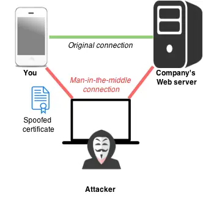

+++
authors = ["Max Katz-Christy"]
title = "Mapping My Leftover Food Tourism"
description = "How to turn eating into a casino game"
date = 2025-02-18
# updated = "2025-02-18"
[taxonomies]
tags = ["TGTG", "Reverse Engineering"]
[extra]
katex = true
banner = "banner.webp"
toc = true
toc_inline = true
toc_ordered = true
# trigger = "This page contains blackjack and hookers, and bad jokes such as this one."
disclaimer = """
- The Too Good to Go API is not meant for this use
- Whoopsies!
"""
[extra.comments]
# Long thread with image
#
# host = "mastodon.social"
# user = "brownpau"
# id = "104529877688537579"
#
# Thread with multiple images per post
#
# host = "mastodon.blaede.family"
# user = "cassidy"
# id = "112774854109302186"
#
# Thread with preview cards
# host = "mastodon.blaede.family"
# user = "cassidy"
# id = "110669429936617026"
#
# Post on GoToSocial
#
# host = "alpha.polymaths.social"
# user = "orbitalmartian"
# id = "01J7ETKJ19FGBDQGS1ZWZ3KEPP"
#
# Post on Sharkey
#
# host = "is-a.wyvern.rip"
# user = "volpeon"
# id = "9qy755nsnu2c0hbc"
host = "better.boston"
user = "maxtkc"
id = "tbd"
+++
# Mapping My Leftover Food Tourism

## An Addict

**Gambling is very addictive**. I have an addictive personality. I have spent
$\\$2079$ in an online casino where the only possible reward is food. This
addiction has caused me to run, bike, and train for miles towards pickup
locations in a variety of far flung places all over the US and Europe.

Maybe this is an unfair comparison because the house and I both usually win.
While I'm not a huge fan of most big companies, Too Good To Go is one of my
favorites.

> [!NOTE]
> [Too Good to Go](https://www.toogoodtogo.com/) is a platform where
> restaurants can post "surprise bags" for around a third of the original price
> that can be picked up in limited numbers at given times.


If it was just for the food alone, I don't know if I would be winning. I spend
lots of time and energy collecting the food. I don't know if there's any
hunter/gatherer left in our DNA, but I do get quite a bit of pleasure from
scouting out what is available and making a collection.


While solo traveling, it gives me a sense of purpose and gives me an excuse to
explore the city in ways that not many others do. And of course, the off chance
encounters with other too good to goers is quite interesting.

## The Problem


The stats in the Too Good To Go app are pretty limited. Also, they are
incorrect. $\\$2148$? They couldn't handle the non USD currencies so they just
dropped them from their calculation? How do I know? I had some trouble with it
myself.

And then CO2 avoided? I mean, who cares about climate change anyways. Why can't
I export the data, or see a map of places I've been? I have so many more
productive things to do, but this is bugging me.

## Existing "Research"

There's a [Too Good To Go python
package](https://github.com/ahivert/tgtg-python) that I've used before, let's
see if that works.

```bash
$ python login_test.py
Using version 26.2.1
Traceback (most recent call last):
  File "/home/maxtkc/Documents/home-docker/random/login_test.py", line 4, in <module>
    client.get_credentials()
    ~~~~~~~~~~~~~~~~~~~~~~^^
  File "/home/maxtkc/.pyenv/versions/3.13.1/lib/python3.13/site-packages/tgtg/__init__.py", line 91, in get_credentials
    self.login()
    ~~~~~~~~~~^^
  File "/home/maxtkc/.pyenv/versions/3.13.1/lib/python3.13/site-packages/tgtg/__init__.py", line 178, in login
    raise TgtgLoginError(response.status_code, response.content)
tgtg.exceptions.TgtgLoginError: (403, b'{"url":"https://geo.captcha-delivery.com/interstitial/?initialCid=AHrlqAAAABCDEXyIx9bnwYMA9bYTBQ==&cid=Lu082uaoDwhP0KABCDEuTPiE_c9rtIFqzWqkz8zEuBIAc7a6KrDfU8zCdWOFw7ygZr2y0VM6JLa8~NVL~4OABCDEo2AMAMbPouApiyiOLVL5aDE73DgvkCiymbs4~Z_A&referer=https%3A%2F%2Fapptoogoodtogo.com%2Fapi%2Fauth%2Fv5%2FauthByEmail&hash=1D42C2CA61ABCDE6E09F294FE96F94&t=it&s=35587&e=68a82f664d769444e5e92acabcde9c196e41b9cd2e8d96dbfffbb462e8d4dd1eec8c4bb847d0eaabcde5ae73b8361fa8&b=2125301"}')
```

Nope, auth issues. This capcha is giving me flashbacks to when I was running
[my notification system](https://github.com/ahivert/tgtg-python) a few years
ago. Let's try [this package](https://github.com/Der-Henning/tgtg).

```bash
$ python test_what_works.py
Testing what endpoints work...

1. Testing get_items (favorites):
✓ get_items works - got 5 items
  Sample item keys: ['item', 'store', 'display_name', 'pickup_interval', 'pickup_location', 'purchase_end', 'items_available', 'distance', 'favorite', 'subscribed_to_notification', 'in_sales_window', 'new_item', 'item_type', 'matches_filters', 'item_tags']

2. Testing get_active:
✓ get_active works
  Response keys: ['current_time', 'has_more', 'orders']
  Full response: {
  "current_time": "2026-02-20T01:15:53.948770426Z",
  "has_more": false,
  "orders": []
}

3. Testing discover/v1/bucket:
✗ Bucket 'History' failed: (400, b'{"errors":[{"code":"VALIDATION_ERROR"}]}')
✗ Bucket 'Orders' failed: (400, b'{"errors":[{"code":"VALIDATION_ERROR"}]}')
✗ Bucket 'PastOrders' failed: (400, b'{"errors":[{"code":"VALIDATION_ERROR"}]}')
✗ Bucket 'CompletedOrders' failed: (400, b'{"errors":[{"code":"VALIDATION_ERROR"}]}')
✗ Bucket 'RedeemedOrders' failed: (400, b'{"errors":[{"code":"VALIDATION_ERROR"}]}')
```

Wheee! It mostly works... But wait, they don't have the history endpoint
included? No one has done this before? We are entering uncharted territory...


## Reverse Engineering

Too Good to Go's API is not documented anywhere or intended for public use
outside of the app. However, my app is able to look at my past pickups. If I
can figure out what API calls (different urls) the app is using, then I can
repeat it in my script!

To make this more interesting, we'll have some actors act it out.

### In the beginning

> **Phone**: I would like to connect securely with Too Good to Go
>
> **Me**: And I'm going to listen in!
> 
> **Too Good to Go**: Ok, I am too good to go, here is my certificate saying
> so! It is mathematically signed by Let's Encrypt 💪
> 
> **Phone**: Ok, i'll use your certificate to send you secret messages no one
> can see
>
> **Me**: Ist das Deutch?! Scheiße.
> 
> *[Scene]*



Ok, we've got to get in the middle of this. Lets use
[mitmproxy](https://www.mitmproxy.org/)! Then we'll be able to see everything.

> [!NOTE]
> A proxy takes unencrypted connections from a device and sends the requests on
> behalf of the device.

### With the proxy

> **Phone**: I would like to connect securely with Too Good to Go
>
> **Me**: And I'm going to listen in!
> 
> **Proxy**: Ok, I am too good to go, here is my certificate saying so! I signed it myself!
> 
> **Phone**: WTF this shit is bogus, no, I don't trust you at all
>
> **Me**: Drat, foiled again.
> 
> *[Phone exits stage right]*

So, when the app tries to connect securely with TGTG, it uses SSL. SSL puts the
`s` in `https`. Every website that supports `https` has a certificate. They get
their certificate signed, mathematically, by a certificate authority (CA) who
is responsible for verifying their identities.

Your phone and your laptop have lists of these authorities that they trust.
When your phone sees a certificate signed by one of these authorities, it can
be fairly certain\* that the certificate was provided by the owner.


> [!NOTE]
> One way to think of certificate authorities is like countries, and
> certificates as passports. When you show your passport to travel, the border
> patrol will see if its from a trusted country and that it's real. Without
> looking anything up in a database, they can be fairly certain you are who you
> say you are.

> [!NOTE]
> \*Why am I only fairly certain? Because if the owner has lost the key to their
> certificate, then someone else could start using it until the owner gets the
> certificate revoked.


So, why is everything failing? To use a proxy with SSL, it will resign every
request with it's own certificate, prentending to be every website you connect
to, so you can feel safe. However, you need to trust the proxies certificate
authority.

> [!NOTE]
> Continuing the metaphore, think of this like someone printing fake passports
> for every country in the world.

### With the proxy certificate authority installed

> *[Phone enters, holding a stack of trusted certificate authorities]*
> 
> **Phone**: I would like to connect securely with Too Good to Go
> 
> **Proxy**: Ok, I am too good to go, here is my certificate saying so! I signed it
> myself!
> 
> *[Phone looks through certificates]*
> 
> **Phone**: Ahh I found one that works, but I don't trust it. I pinned a few
> certificates that I support, and you can't change them, sorry.
> 
> *[Phone exits stage left]*

Ok, the app is stubborn. But we can fix this. There is a special tool made by
the same proxy that I'm using:
[android-unpinner](https://github.com/mitmproxy/android-unpinner)

After some dookie dookieing around, this tool can take an APK (the app file)
and marks the app as debuggable. Then we reinstall the new app, cross our
fingers, and...

### With the app unpinned

> *[Phone enters, looking a little bit fed up with all of this]*
> 
> **Phone**: I would like to connect securely with Too Good to Go
> 
> **Proxy**: Ok, I am too good to go, here is my certificate saying so! I signed it
> myself! But I think you trust me now...
> 
> *[Phone looks through certificates]*
> 
> **Phone**: Dang, I actually do trust you! Lets give you all of my secrets
> now.
> 
> *[Phone starts yapping uncontrollably]*


And we've got it! Now, we listen to the requests streaming through and look for
the history api. After delivering the examples from the app to an LLM, we
receive a patched version of [Der Henning's TGTG
client](https://github.com/Der-Henning/tgtg/blob/main/tgtg_scanner/tgtg/tgtg_client.py).

Then a little bit of scripting and we have...

{{ tgtg_init() }}

{{ hero() }}

{{ viz_map() }}

{{ viz_calendar() }}

{{ viz_galaxy() }}

{{ viz_radial() }}
