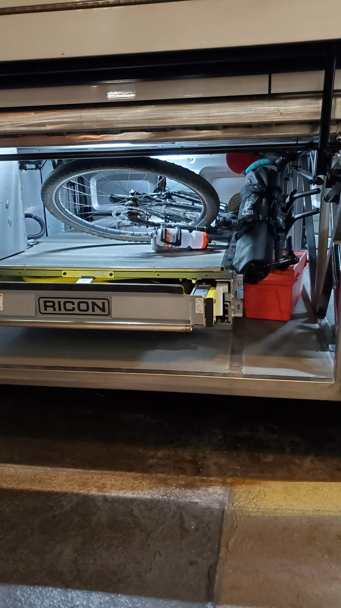
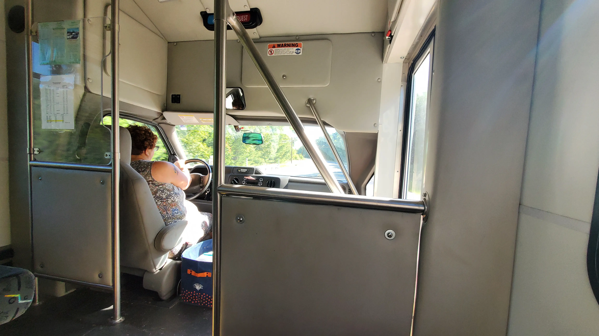
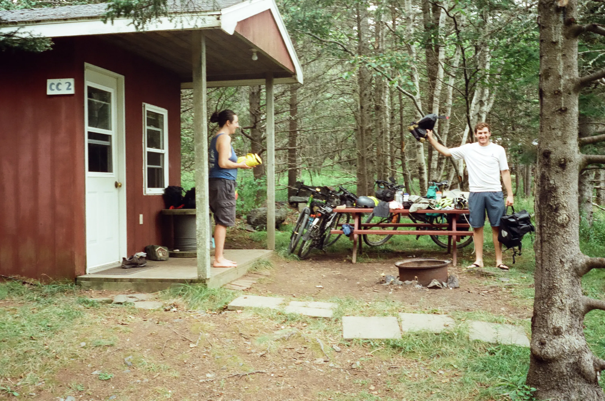
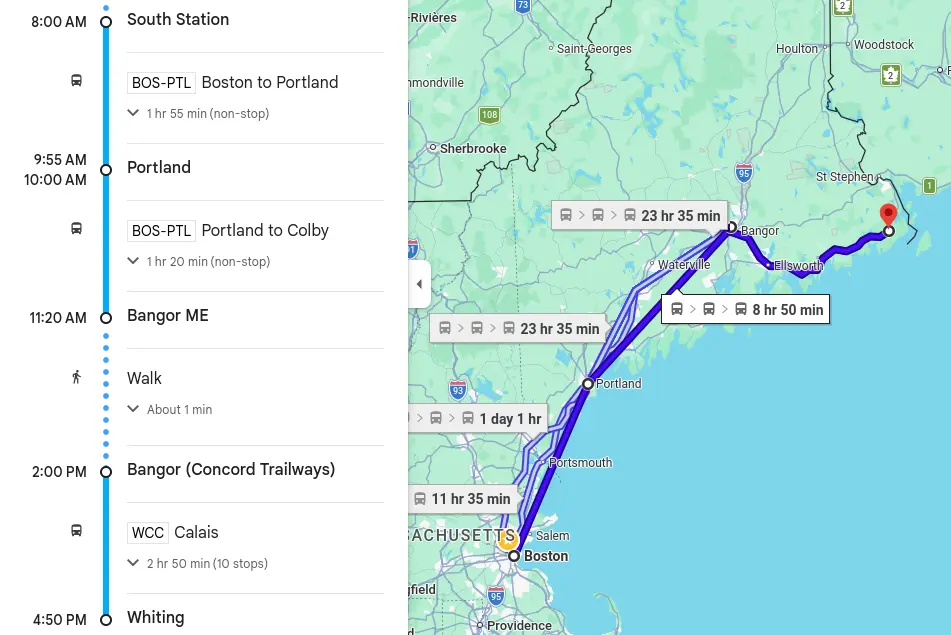
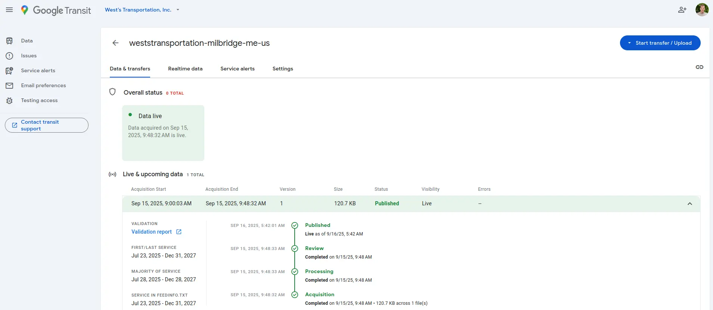
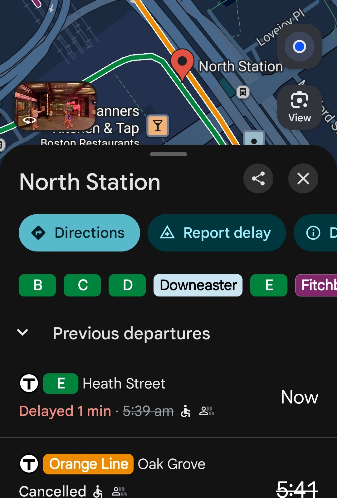

+++
authors = ["Max Katz-Christy"]
title = "How I became a freelance rural bus Google Mapsifier"
description = "How a bike tour to Canada led me to building software for some bus services in the boonies"
date = 2026-04-03
updated = "2026-04-04"
[taxonomies]
tags = ["GTFS", "Data"]
[extra]
katex = true
banner = "sunset_grand_manan.webp"
toc = true
toc_inline = true
toc_ordered = true
[extra.comments]
host = "better.boston"
user = "maxtkc"
id = "tbd"
+++
### A plan

<!-- thx for review! -->

A few years back, I sent this itinerary to my sister and dad, who I would be
joining a couple days later:

> Concord Coach
> - Boston South Station 8:00 AM -> Bangor 12:10 PM (Dad)
> - Portland 10:00 AM -> Bangor 12:10 PM (Mo)
> 
> West's Transportation
> - <http://www.westbusservice.com/>
> - 1-800-596-2823
> - Bangor (Concord Trailways) 2:00 PM -> Whiting (Community Center/Store) 4:50
>   PM
> - $26/person + $7/bike
> - Correct change only
> 
> Whiting -> Lubec
> - Cycling
> - 11.2 mi
> - Take ME 189 East out of Whiting, continue straight 11.2 mi to Lubec
> 
> Time Zone Change! Times in this list will now be in ADT = EDT + 1
> 
> Campobello Island
> - Cycling Lubec -> Welshpool
> - Border Crossing
> - 3.5 mi
> - Cross the bridge to the island
> - Follow the main road untill it ends
> - Turn Left, and the ferry should be on your left
> 
> East Coast Ferries Ltd
> - <http://www.eastcoastferriesltd.com/Fares-Schedule.html>
> - (506) 747-2159
> - Cash, Debit or Credit
> - Leaves Campobello on the hour starting at 9:00 AM ending at 7:00 PM
> - Bicycles/Passenger - $7.00
> 
> Deer Island
> - Cycling
> - 9.3 mi
> - Go on the road north, then turn right or left
> - If you go left, you go through fairhaven
> - If you go right, you go through Leonardville (slightly longer)
> - Turn North when the roads hit a T intersection on the big road towards
>   Stuart
> - Town where your next ferry is
> 
> Coastal Transport
> - <https://deerisland.coastaltransport.ca/schedule.html>
> - (506) 662-3724
> - Leaves Deer on the half hour starting at 6:00 AM ending at 10:00 PM
> - Free!
> 
> L'Etete -> Blacks Harbor
> - 23.4 mi
> - Either take ME 172 (Right) to St George or take Mascarene Road (Left, maybe
>   nicer)
> - Regarless, you'll end up on ME 172/Fundy Bay Drive
> - Turn Left on L'Etete Road After the Irving Gas Station
> - Quickly turn Right on Main Street
> - Quickly turn right on the NB trail after Simpson Court
> - Turn right on ME 785 at the Wilsons Gas Station
> - Turn Right on ME 176/785 over Rt 1
> - At the Harbor Tide Inn B&B, turn right on Main St
> 
> Coastal Transport
> - <https://grandmanan.coastaltransport.ca/schedule.html>
> - (506) 662-3724
> - Leaves Deer on the half hour starting at 6:00 AM ending at 10:00 PM
> - Fees are only charged on the way back (good luck charlie!)
> - Departing Black's Harbor: 7:30 AM, 9:30 AM, 11:30 AM, 1:30 PM, 3:30 PM,
>   5:30 PM, 9:00 PM
> - Departing Grand Manan: 7:30 AM, 9:30 AM, 11:30 AM, 1:30 PM, 3:30 PM, 5:30
>   PM, 7:15 PM
> - $13/Person + $4.50/Bicycle
> - In Person Payment Methods
> - Cash, debit or Visa, MasterCard, and American Express
> 
> I digress. At this point, have fun on the island, hopefully I'll be there.
> Maybe go over to White's Head on the ferry (also run by coastal transport and
> free). Should be very doable. Stay wherever you want (I think it's pretty
> rural). Call if you're lost, or just ask someone. The general idea after this
> is just to go to Calais and catch the West's bus back home.
> 
> Conversions
> - Where is? Ou est? Ex. Ou est Black's Harbor?
> - How much does this cost? Combien ça coûte? Pronounced, "Com-bee-en sa coot"
> - I'm realizing that they might not speak french there...
> - EDT = ADT - 1
> - ADT = EDT + 1
> - $1 CA = $0.74 US
> - $1 US = $1.35 US
> - Don't get scammed at the border!
> - Don't lose your passport!

I know, I should start a trip planning agency with these incredible design
skills 😬.

Finding out that West Bus even existed was a very difficult task. Since the
time of writing, the state of Maine has improved their list of services on this
page: <https://www.maine.gov/dot/programs-services/transit/public-transit>

If you've memorized your Maine region numbers and the name of every town
inhabited by at least ten beavers, you will have no trouble finding your
desired bus. So, after opening basically every website, I found the West's
Coastal Connection route run by West Bus: <https://westbusservice.com/>

Every other time I wanted to find their website, I would try to find it on
Google, but that would only provide me some old PDF from the state of Maine
that had outdated information.

Even when you finally find it, West Bus’s website doesn’t exactly inspire
confidence or provide important information easily. So, we were mildly
surprised and very relieved when the bus actually showed up in Bangor. After
paying cash for a paper ticket for us and our bikes, the bus did take us the
expected route to Whiting, where we were able to have a wonderful vacation in
New Brunswick, Canada.

<figure>

  
  <figcaption>My bike on top of the wheelchair lift on the prior Concord Coach bus</figcaption>
</figure>

> [!TIP]
> With Concord Coach: They (and some other bus companies) allow bikes
> "when there is space". There is **almost always** space above the wheelchair
> lift. You can suggest it to the driver if they are worried about your bike
> poking another passenger's bag. All the Concord Coach drivers I've
> encountered so far have been fantastic.

<figure>

  
  <figcaption>West's Coastal Connection, a spectacular photo from the inside of the shortbus</figcaption>
</figure>

<figure>

<figure>

  
  <figcaption>Camping on some little island in Canada</figcaption>
</figure>

<figure>

  
  <figcaption>Lots of the little ferries in Canada are free for bikes</figcaption>
</figure>

<figure>

  
  <figcaption>Glamping!</figcaption>
</figure>

<figure>

  
  <figcaption>The tree doesn't grow too far from the apple...</figcaption>
</figure>

<figure>

  
  <figcaption>This is what you end up on when you ask me for a nice route with paved roads</figcaption>
</figure>

### My intervention

I know how to build websites, I can fix this. I threw something together (this
was pre-llms) and emailed it to them:
<https://maxtkc.github.io/wests-bus-sample/>

For 1 year, I received no response. The following summer, my parents took the
bus from Canada, and I sent them on a special mission to figure out who was in
charge.

> Subject: [Attention Julie!] Offering Website Assistance
>
> Hi Julie,
>
> My name is Max Katz-Christy, and I am one of your happy passengers and I
> would like to provide you with a website update. My parents recently used
> your bus and told me that you are who I should bring this to. I am a software
> developer, and I'd like to volunteer to help you use make your website:
>
> - easier to search for
> - more accessible
> - in a more modern format
> 
> Here is a sample website I have created that I could easily provide to you:
> <https://maxtkc.github.io/wests-bus-sample/>
> 
> I also may be able to help you comply with the FTA's somewhat recent
> requirement that all transportation agencies provide data to them:
> <https://www.federalregister.gov/documents/2022/07/07/2022-14502/national-transit-database-reporting-changes-and-clarifications>
> 
> In short, I am a software developer who loves the connection that your bus
> makes and I have built a website presenting the exact same information that
> you have on your current website but in a more readable fashion.
> 
> About myself, I am 23 years old and an undergraduate student at MIT. I love
> traveling with my bicycle and on buses and trains. I race sailboats, mountain
> bikes, and play ice hockey.
> 
> I sent you an email about a year ago with this, but I think it may have
> gotten lost. I'd love to make this happen. There are absolutely no strings
> attached, I am doing this because I want more people to be able to ride your
> bus.
> 
> Best,
>
> Max

Soon after I sent that letter, I had the pleasure of chatting with Julie and
Jolyne on the phone, who explained that, due to very unfortunate circumstances,
they had completely lost access to updating their website. Though I was
disappointed that they were not interested in my updated website ("we like the
red text"), I was happy to help solve their more fundamental issues.

They quickly trusted me so much they sent me all of the passwords they knew
about. They were paying for some strange ancient and expensive hosting service,
so I moved them to GitHub pages and pointed their domain to it. I made a GitHub
organization so they have the same access to it that I have and would not need
to email me passwords or share mine. They wanted a banner on the site where
they can post updates, so there is a file that they can update, triggering a
build that places the text in a yellow banner at the top of the page.

Next, I boosted their SEO to the mooooon! They are the first result for “west
bus maine”. Booya. This was done by registering them with Google, proving
ownership, and then improving the performance of the page as well as other web
“best practices” for which Google gives you brownie points.

### Mission Deux: a forwarded email from MaineDOT

> "We are in need of help with this email and attachment. We have [no] idea
> what most of it means or how to do. Would you be able to look it over and let
> us know if this is something you are able to do for us?"

Twist my arm. What were they asking for? A GTFS feed.

And what is a GTFS feed, you may ask? It's a transit agency's timetable,
written for computers. It's a big file describing every scheduled trip on every
route that an agency will take. Even my 7:23 Red Line train from Porter? Yup.
The minute it is supposed to depart is in there.

Well, who is using this big stupid file? Why's it so damn important? While I do
like me a good GTFS file for breakfast, it's also used by the state of Maine
for their record keeping, and... you! Do you use Google Maps or Apple Maps
(yikes) and navigate with public transit directions? If so, you are using GTFS.
Google and Apple each have lists of urls for different agencies GTFS files
(confusingly called "feeds"), and every so often they go through every file and
download it, providing updated schedules to travelers. This is how you can
navigate from Boston to the Canadian border using a bespoke agency like West
Bus: <https://maps.app.goo.gl/RnuhJyURxH4MM9H98>

For West Bus, I wrote this crappy script to generate their feed:
<https://github.com/west-bus-service/single-page-site/blob/main/scripts/gen_gtfs.py>

It was before AI, so there are no comments in the code, sorry. However, it
works. A GTFS feed (it just means file you can get on the internet) is simply a
zip file. When you expand it, you'll see a bunch of `.txt` (text) files. If you
look at any of these, you'll notice that every single file is really just a
`csv`, which can be loaded in Excel! If you want to dig around deeper, you can
check out "the bible" of GTFS:
<https://gtfs.org/documentation/schedule/reference/> showing exactly how every
file should be formatted. You can also download the MBTA's GTFS from their
website and add lots of service along your favorite route exactly to your needs
and email them the file as a suggestion: <https://www.mbta.com/developers/gtfs>

You might notice how the first half of the route to Canada shows those ugly
straight lines. Concord coach does not in fact operate flying buses that go
directly from South Station to Maine. They just forgot to include the optional
yet coveted `shapes.txt` file. I sent them a feed too, but they have been
ghosting me.

Now, once you write the file, all you've got to do is submit it to Google and
then, voila, right?

Nope.

### Mission Tree: Google QA

>[!NOTE]
> QA = Quality Assurance

> It appears that some stops defined in the feed do not match their actual
> physical locations.
> 
> -Google

Yeah. Well, if I'm being honest, I had no clue exactly where they stopped. The
website refers to some quite... Maine places: "Swamp Yankee BBQ" (permanently
closed) and "Elmer’s Discount".

You start off by submitting a Google form, with your interest in the program.
Next, you need to verify that you are the owner or approved by the owner to
submit the schedule. Then, you go back in forth for many months where they take
a long time to give you feedback, and then you take a while to respond because
you kinda forgot about it, and it goes back and forth until you have a 50+ long
email thread with attachments bogging down your Google storage to the point
where, every month, you are deleting various other emails so you can get a few
bytes below the 15 GB maximum and evade the impending doom of the "you will not
be able to send or receive emails in 3 days if you do not get your shit
together" emails.

The process with Google starting in December 2024 managed to take less than one
year. In September 2025, West Bus went live on Google!

I should note that it also works on the other mapping services. However, they,
including Apple, do not have an independent submission process. They use lists to which you sumbit a url to, and honestly I have no clue if they do
any vetting at all.

### A Regulah: Round Zwei

> Hey, how much fun was it to make the GTFS feeds for West Bus and Concord?
> Would you be interested in making a feed for another small New England
> regional system that desperately wants to publish it? A friend moved to this
> town and knew I might know a way to get them on the map:
> <https://publictransportation.columbiacountyny.com/>

I'm like a digital minuteman. This is my call to action. The British are
coming, the British are coming! The FTA is asking for a GTFS feed, the FTA is
asking for a GTFS feed! I've got my musket and my whisky and I'm on my way to
the town square to write some code for another rural transit service that feels
like their website may have predated the Minutemen.

> [!NOTE]
> The Minutemen were a volunteer army of sorts who helped fight off the British
> when they attacked because they were mad the Bostonians were rejecting their
> authority and dumping their tea into the harbor. The Minuteman legacy lives
> on as the name of a bicycle path and a technical high school.

> [!NOTE]
> A further note, and one which I learned from the back of a children's book,
> they didn't actually say "the British are coming" because they considered
> themselves to be British. They were more likely to have said, "the Kings Men
> are coming", but that doesn't have the same ring to it.

This process had some improvements over the prior. First, I had two people with
knowledge of the system to work with. I also had a bit more experience from the
prior attempt. Nevertheless, I made another complicated python system to
generate the zip file: <https://github.com/columbia-county-ny-transit/gtfs-generator>

One of the people from Columbia County was able to make updates to it, which
was cool. However, making a change more than moving a stop is a bit
challenging. Additionally, you really have no clue if you get the change right.
I have yet to find a good GTFS visualizer that is easy to install and gives you
a good picture of what the heck is going on.

Despite these advantages in our process, we submitted to Google in September
2025 and only managed to publish it March 2026.

### Next Steps: Absolutely laying waste to my sleep schedule

As much as I like building GTFS feeds, it gets old after a bit. Plus, I'm not
going to know the exact location where the buses are supposed to stop nearly as
well as the agency themselves. They should be using a tool.

Here is the list of existing tools for making GTFS feeds:
<https://gtfs.org/resources/producing-data/>

At first, you think, "Wow, what an abundance of tools! What is bozo getting all
pissy about?" Then you slowly realize that every one of these tools does
something you don't expect or hasn't been updated in 10 years. It's incredibly
disappointing.

> [!NOTE]
> My mother (and chief editor) would like me to specify that "bozo" (above) is
> me. That was one of the many words I learned in college, along with "aura",
> "sigma", "rizz", "huzz", and "brainrot" all while attempting to not get last
> place in sailboat races. Apparently, this qualifies me to work as a computer
> scientist now 🤯

Anywho, I bet you can see where this is going. The product of many hours of late night
work has resulted in this quickly evolving tool: <https://edit.gtfs.zone/>

The tool is a fully static web app, meaning that it stores no data on a server
and is running entirely in your browser. This has many advantages. There is no
login/security to worry about. It's very reliable, because to reset it in the
worst case, all you have to do is clear the storage in your browser. It also
doesn't rely on anything to be installed on your computer to run. It even sort
of runs on your phone (though I have not yet optimized it for mobile). In the
last week, I believe it has become usable enough to enable a rural transit
agency with a standard schedule to maintain their own feed.

### Aside: a discussion about AI

> [!NOTE]
> Feel free to skip this section, it's a bit rambling

I would like to discuss my use of AI to build the tool. This was my first foray
into developing with LLMs. Until the summer of 2025, I hadn't really touched an
LLM. I thought they were stupid and I was doing fine without them. However, I
think that was because I hadn't yet tried the right tools. This project was my
introduction to using Claude Code. The project is perfectly positioned to be
worked on by Claude Code as a static web app. I can let it stomp around in the
code all over the place and as long as my manual tests succeed, then Claude has
done its work correctly. It's fully contained, so it can easily get a clear
picture of what is going on and write code.

This does not mean that I am able to sit back and press play. I still have to
be very involved in deciding what tools to use and higher level design
decisions. It's like a super speedy but sometimes stupid developer. Context
management is also very important. If you give it too much to do at once, by
the end it will slow down and get all confused and start doing silly things.
The great part about all of this is that it encourages me to implement many of
the best programming practices. Sometimes when doing a solo project, it is easy
to let yourself skip the high level planning because it's all laid out in your
head. But here I can't do that, because I have someone else reading (and writing)
my code.

I should also discuss the fact that I pay $20 a month to a company that is
spending lots of money to use tons of electricity and water for cooling at data
centers in places where other people live. Here is my excuse, though I am not
confident in it: the inference (coming up with answers to my stupid questions)
does not actually use that much electricity relative to the training (building
new models). The improvement from training is becoming less and less
significant. Soon, there will be less incentive to train more and just to run
inference on existing models. Not the best excuse so, maybe I'll change my
usage in the future.

All my writing (besides documentation) is AI free, because I enjoy the process.
Editing is done by my mother. Thank you mom! My father sometimes looks at it
and then quickly starts telling me about the latest piece of electronics from
the 1800s he's reverse engineered into something that can be accomplished by
even the dumbest of phones. My cat doesn't even try, he's too busy terrorizing
the animals in the neighborhood and then befriending all the humans so he can't
face justice for his actions. Corrupt little bugger.

### Further strides: This is all cool, but what if the bus is running late?

No, buses are never late! Late is simply a social construct, anyway; it's all
just based on expectations. You just gotta chill out, dude.

After taking a beautiful high speed train to Florence, I had to wait an hour
for my bus to the suburb of Greve. I decided to do some tourism and wander
through the city to another point further along the route. I arrived five
minutes before the bus's scheduled departure, but there was no stop to be seen.
This rural bus only runs every couple hours, so I quickly installed the
official app to verify the stop location. As I was doing this, I noticed a more
official looking stop with a real time display on a post one block away.
However, the app confirmed with Google that the stop location was on this
block. I figured I should check the other one out, and I was close enough I
could run back if the bus did come.

The realtime display did not show my bus at all. Huh. There was a younger
person at the stop, and I hoped that they spoke English. Unfortunately they
didn't but I did some point and shoot with my phone and the bus number and they
gave me a slight bit of confidence the bus would stop there. However, it was
already 15 minutes late. People came and went from the stop. I was the only
permanent fixture.

I felt like a fool.

I was relieved of my foolish feelings quite a bit later when a bus did finally
show up. However, if I had just known the correct stop location and that the
bus was running late, I would have just done a little more tourism, relaxed,
and caught my bus when it came.

There is a second part to GTFS that I haven't yet discussed. When a transit
agency has a delay, construction, or some realtime event, they might have to
deviate from their scheduled/static GTFS. This is where GTFS realtime comes in.
If you look on Google Maps, you know that a transit agency supports GTFS
realtime if an upcoming trip reads "on time/x mins delayed" instead of
"scheduled". I will discuss this more in the future, but you can demo/test the
tool I am building for GTFS realtime here: <https://gtfs.zone/realtime-setup/>
and read more about the system behind it here:
<https://git.kcfam.us/gtfs.zone/deploy-gtfs-rt/>

### What can you do?

I dunno. Can ya juggle?

- You can play with the editor: <https://edit.gtfs.zone>
- You can try the GTFS realtime: <https://gtfs.zone/realtime-setup/>
- You can write some issues, or just send them to me!
    - For the editor: <https://git.kcfam.us/gtfs.zone/coloring-book/issues>
    - And for the realtime: <https://git.kcfam.us/gtfs.zone/deploy-gtfs-rt/issues>
- You can probably do a lot of better things than read all to the end of this
  blog post. However, I'm impressed you made it here (and a bit concerned), but
  maybe that means you have already solved all the other problems in your life
  and you have come to solve mine!
