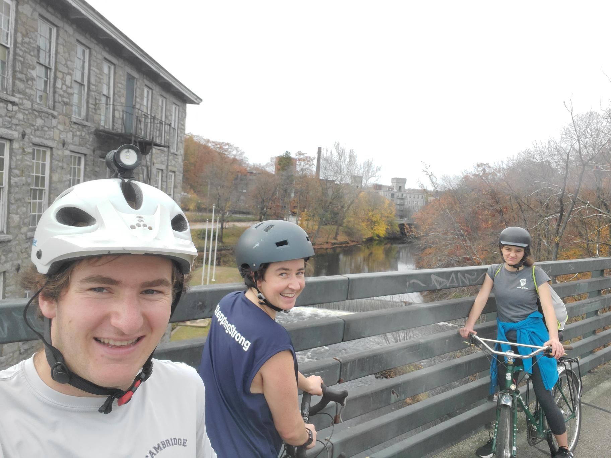

+++
title = "Sibling Providence Loop 1st Half"
description = "Ride — 2022-11-05"
date = 2022-11-05
authors = ["Max Katz-Christy"]

[taxonomies]
tags = ["Ride"]

[extra]
banner = "banner.jpg"
strava_id = 8074174706
distance_fmt = "90.73 km"
moving_time_fmt = "5h 38m 00s"
elevation_gain_fmt = "645 m"
+++

## Stats

| | |
|---|---|
| **Distance** | 90.73 km |
| **Moving time** | 5h 38m 00s |
| **Elapsed time** | 7h 46m 14s |
| **Elevation gain** | 645 m |
| **Average speed** | 16.1 km/h |
| **Max speed** | 46.5 km/h |
| **Calories** | 1897 kcal |
| **Achievements** | 5 |
| **Device** | Garmin fēnix 6X |

## Route

{{ strava_map() }}

[View on Strava](https://www.strava.com/activities/8074174706)

## Photos

