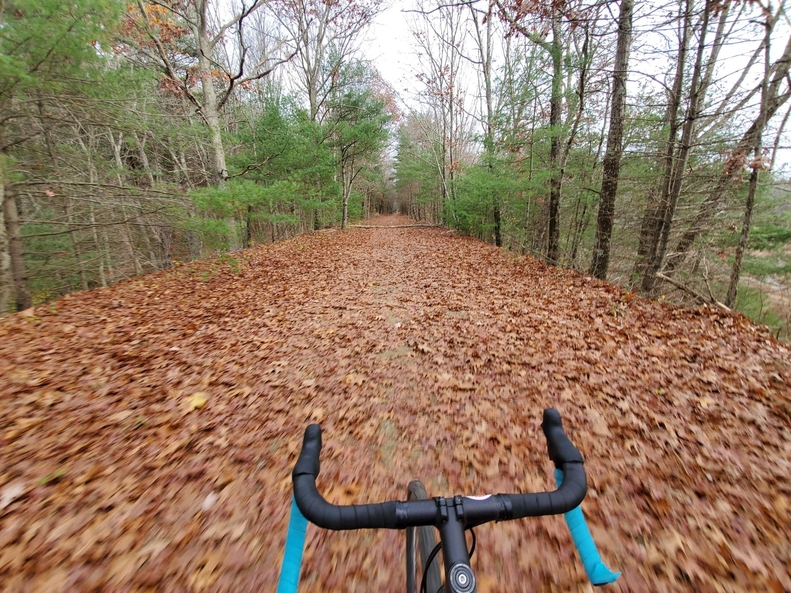

+++
title = "Sibling Providence Loop 2nd Half"
description = "Ride — 2022-11-06"
date = 2022-11-06
authors = ["Max Katz-Christy"]

[taxonomies]
tags = ["Ride"]

[extra]
banner = "banner.jpg"
strava_id = 8079505971
distance_fmt = "79.71 km"
moving_time_fmt = "4h 57m 11s"
elevation_gain_fmt = "361 m"
+++

## Stats

| | |
|---|---|
| **Distance** | 79.71 km |
| **Moving time** | 4h 57m 11s |
| **Elapsed time** | 5h 59m 21s |
| **Elevation gain** | 361 m |
| **Average speed** | 16.1 km/h |
| **Max speed** | 47.0 km/h |
| **Calories** | 1655 kcal |
| **Device** | Garmin fēnix 6X |

## Route

{{ strava_map() }}

[View on Strava](https://www.strava.com/activities/8079505971)

## Photos

