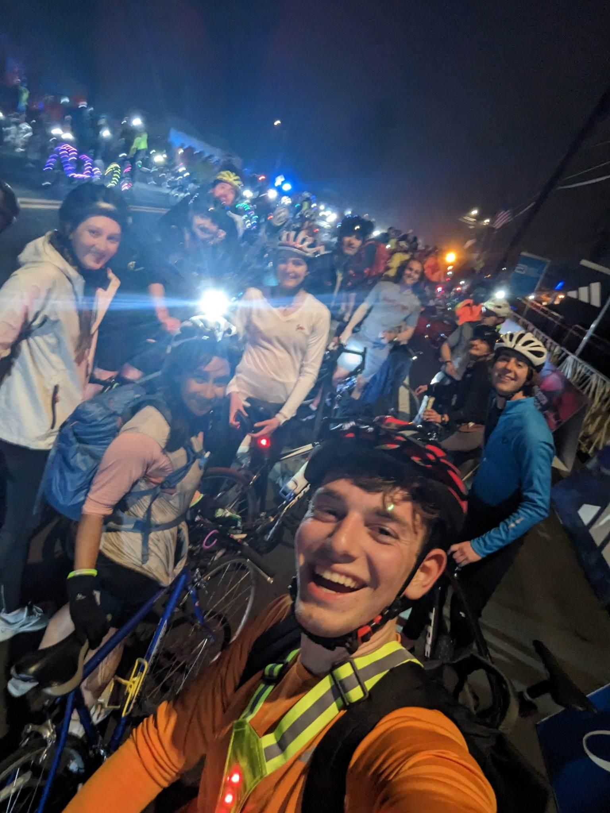

+++
title = "Midnight Marathon Ride"
description = "Ride — 2023-04-16"
date = 2023-04-16
authors = ["Max Katz-Christy"]

[taxonomies]
tags = ["Ride"]

[extra]
banner = "banner.jpg"
strava_id = 8905491824
distance_fmt = "89.99 km"
moving_time_fmt = "4h 20m 19s"
elevation_gain_fmt = "705 m"
+++

## Stats

| | |
|---|---|
| **Distance** | 89.99 km |
| **Moving time** | 4h 20m 19s |
| **Elapsed time** | 5h 25m 28s |
| **Elevation gain** | 705 m |
| **Average speed** | 20.7 km/h |
| **Max speed** | 49.0 km/h |
| **Calories** | 1546 kcal |
| **Achievements** | 122 |
| **Device** | Garmin fēnix 6X |

## Route

{{ strava_map() }}

[View on Strava](https://www.strava.com/activities/8905491824)

## Photos

