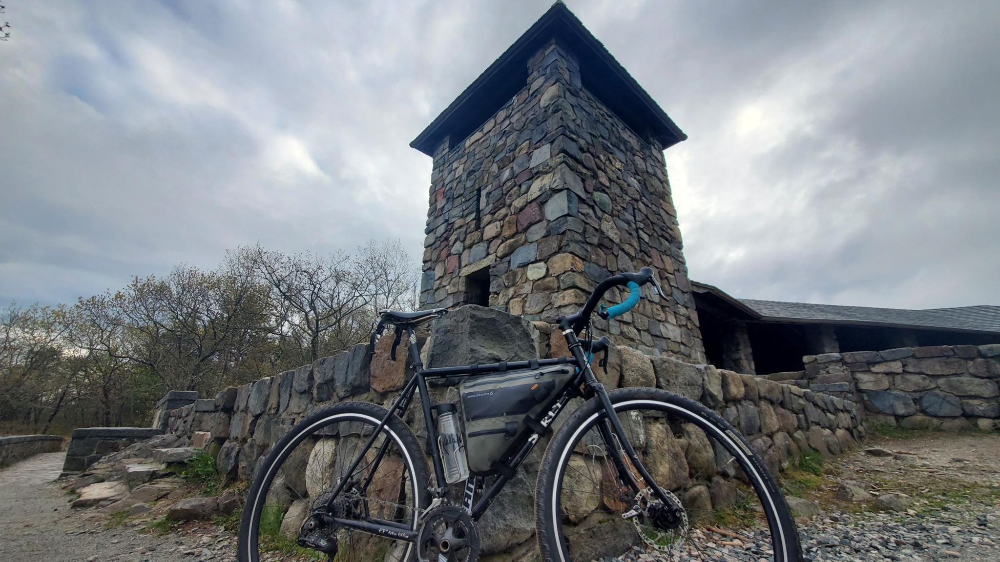

+++
title = "Blue Hill "
description = "Ride — 2023-05-03"
date = 2023-05-03
authors = ["Max Katz-Christy"]

[taxonomies]
tags = ["Ride"]

[extra]
banner = "banner.jpg"
strava_id = 9005999673
distance_fmt = "42.19 km"
moving_time_fmt = "1h 52m 45s"
elevation_gain_fmt = "391 m"
+++

## Stats

| | |
|---|---|
| **Distance** | 42.19 km |
| **Moving time** | 1h 52m 45s |
| **Elapsed time** | 2h 09m 14s |
| **Elevation gain** | 391 m |
| **Average speed** | 22.5 km/h |
| **Max speed** | 45.9 km/h |
| **Calories** | 847 kcal |
| **Achievements** | 32 |
| **Device** | Garmin fēnix 6X |

## Route

{{ strava_map() }}

[View on Strava](https://www.strava.com/activities/9005999673)

## Photos

