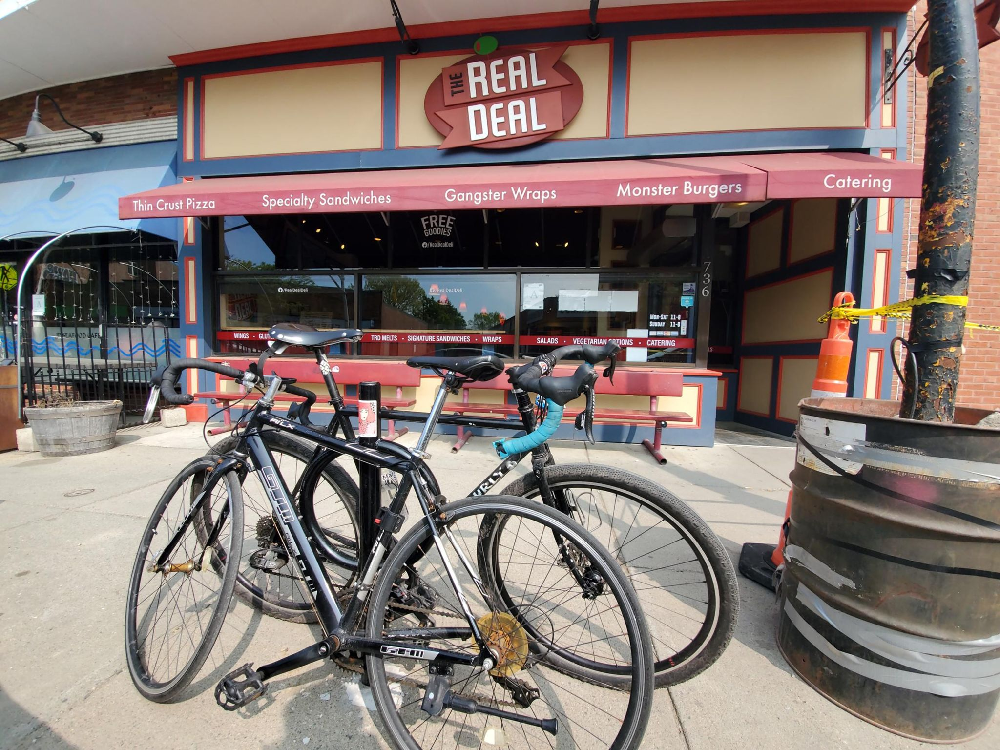

+++
title = "Back on the roads (mostly)"
description = "Ride — 2023-05-09"
date = 2023-05-09
authors = ["Max Katz-Christy"]

[taxonomies]
tags = ["Ride"]

[extra]
banner = "banner.jpg"
strava_id = 9042026110
distance_fmt = "32.57 km"
moving_time_fmt = "1h 39m 15s"
elevation_gain_fmt = "347 m"
+++

## Stats

| | |
|---|---|
| **Distance** | 32.57 km |
| **Moving time** | 1h 39m 15s |
| **Elapsed time** | 2h 24m 38s |
| **Elevation gain** | 347 m |
| **Average speed** | 19.7 km/h |
| **Max speed** | 45.3 km/h |
| **Calories** | 669 kcal |
| **Achievements** | 2 |
| **Device** | Garmin fēnix 6X |

## Route

{{ strava_map() }}

[View on Strava](https://www.strava.com/activities/9042026110)

## Photos

