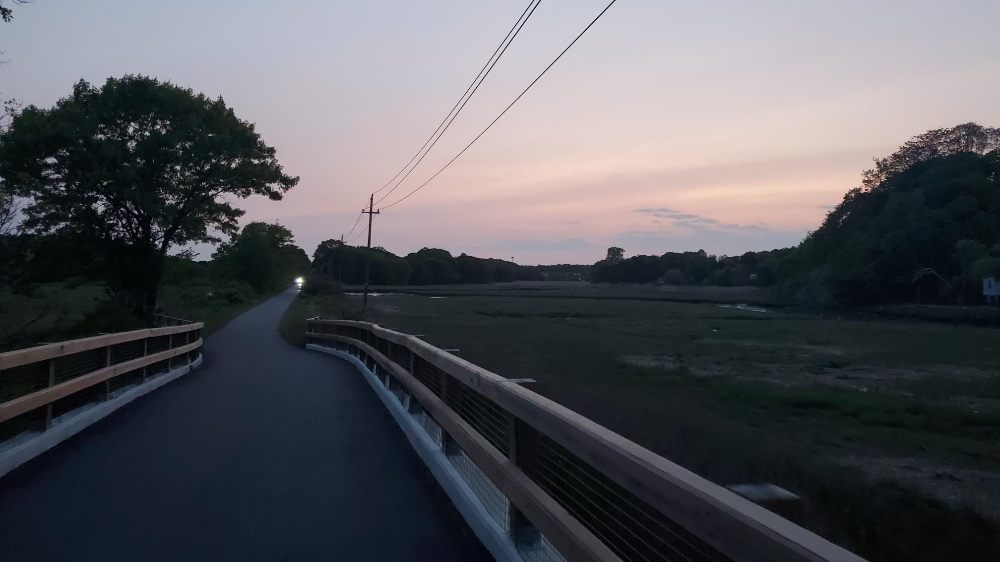

+++
title = "Dark Northern Dirt"
description = "GravelRide — 2023-05-23"
date = 2023-05-23
authors = ["Max Katz-Christy"]

[taxonomies]
tags = ["GravelRide"]

[extra]
banner = "banner.jpg"
strava_id = 9128995708
distance_fmt = "58.06 km"
moving_time_fmt = "2h 50m 48s"
elevation_gain_fmt = "440 m"
+++

https://www.urbandirt.org/routes/light-northern-dirt

## Stats

| | |
|---|---|
| **Distance** | 58.06 km |
| **Moving time** | 2h 50m 48s |
| **Elapsed time** | 3h 04m 15s |
| **Elevation gain** | 440 m |
| **Average speed** | 20.4 km/h |
| **Max speed** | 42.4 km/h |
| **Calories** | 1903 kcal |
| **Achievements** | 12 |
| **Device** | Garmin fēnix 6X |

## Route

{{ strava_map() }}

[View on Strava](https://www.strava.com/activities/9128995708)

## Photos

