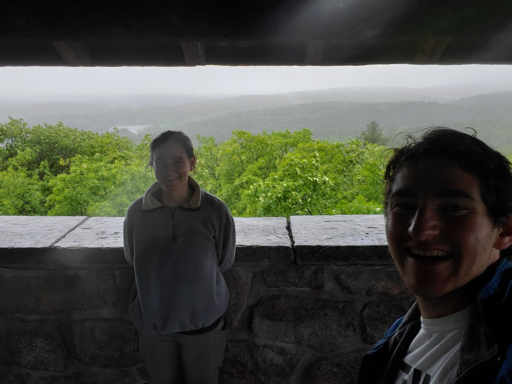

+++
title = "Reverse Wet Rock Blues and Bailout to Little Duck"
description = "GravelRide — 2023-06-03"
date = 2023-06-03
authors = ["Max Katz-Christy"]

[taxonomies]
tags = ["GravelRide"]

[extra]
banner = "banner.jpg"
strava_id = 9197055234
distance_fmt = "42.98 km"
moving_time_fmt = "2h 35m 11s"
elevation_gain_fmt = "306 m"
+++

https://www.urbandirt.org/routes/stony-blues

## Stats

| | |
|---|---|
| **Distance** | 42.98 km |
| **Moving time** | 2h 35m 11s |
| **Elapsed time** | 4h 48m 46s |
| **Elevation gain** | 306 m |
| **Average speed** | 16.6 km/h |
| **Max speed** | 45.8 km/h |
| **Calories** | 988 kcal |
| **Achievements** | 23 |
| **Device** | Garmin fēnix 6X |

## Route

{{ strava_map() }}

[View on Strava](https://www.strava.com/activities/9197055234)

## Photos

