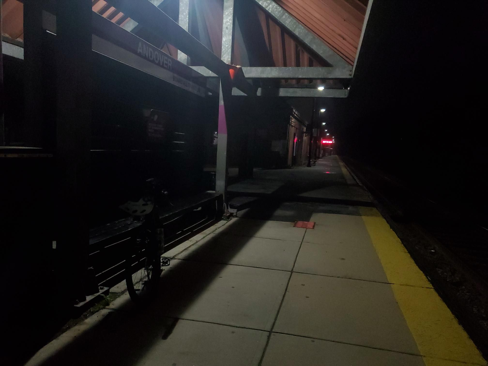

+++
title = "Missed the JRA cancellation, hope I don't miss the train"
description = "GravelRide — 2023-06-26"
date = 2023-06-26
authors = ["Max Katz-Christy"]

[taxonomies]
tags = ["GravelRide"]

[extra]
banner = "banner.jpg"
strava_id = 9341190538
distance_fmt = "44.92 km"
moving_time_fmt = "2h 42m 53s"
elevation_gain_fmt = "533 m"
+++

Me and a fellow non Instagram user who happened to also be an NTC runner rode the JRA ride despite the "rain" and I continued onto hella north
It was very hard, especially because everything was wet and it got dark, so I bailed and went straight for the train (which I was planning on stopping at anyways)

https://www.urbandirt.org/routes/hella-north

## Stats

| | |
|---|---|
| **Distance** | 44.92 km |
| **Moving time** | 2h 42m 53s |
| **Elapsed time** | 3h 15m 56s |
| **Elevation gain** | 533 m |
| **Average speed** | 16.5 km/h |
| **Max speed** | 47.3 km/h |
| **Calories** | 764 kcal |
| **Achievements** | 2 |
| **Device** | Garmin fēnix 6X |

## Route

{{ strava_map() }}

[View on Strava](https://www.strava.com/activities/9341190538)

## Photos

