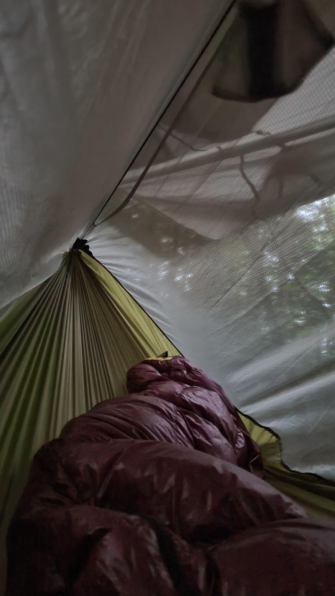

+++
title = "Somehow I was probably more surprising to the skinny dippers than they were to me"
description = "GravelRide — 2023-06-30"
date = 2023-06-30
authors = ["Max Katz-Christy"]

[taxonomies]
tags = ["GravelRide"]

[extra]
banner = "banner.jpg"
strava_id = 9365477605
distance_fmt = "29.33 km"
moving_time_fmt = "1h 23m 00s"
elevation_gain_fmt = "332 m"
+++

Wanted to make some progress towards the promised land. Tried to take a road that was closed and came to a beach at 11pm or so where some people were enjoying the beach at night. I saved the rerouting for the morning and got my hammock up despite the best efforts of the mosquitos

## Stats

| | |
|---|---|
| **Distance** | 29.33 km |
| **Moving time** | 1h 23m 00s |
| **Elapsed time** | 1h 32m 23s |
| **Elevation gain** | 332 m |
| **Average speed** | 21.2 km/h |
| **Max speed** | 59.5 km/h |
| **Calories** | 524 kcal |
| **Device** | Garmin fēnix 6X |

## Route

{{ strava_map() }}

[View on Strava](https://www.strava.com/activities/9365477605)

## Photos

