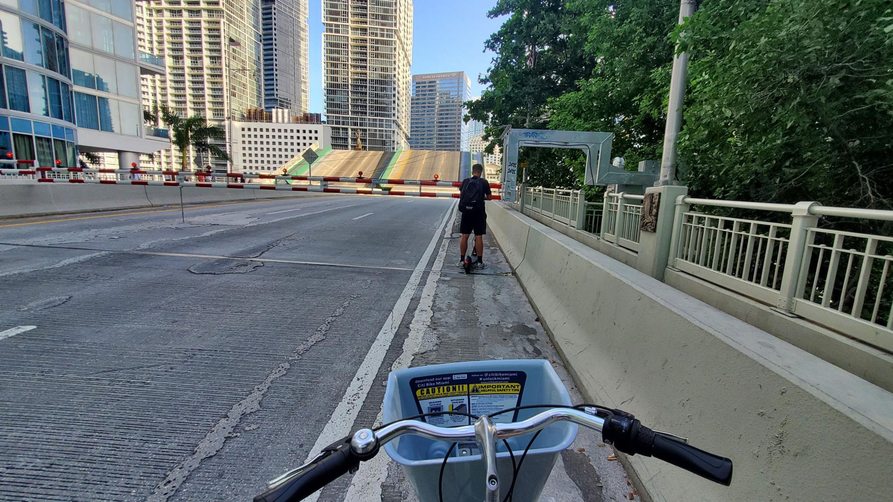

+++
title = "Running with a sea of runners in a sea of sweat by the sea"
description = "Run — 2023-07-11"
date = 2023-07-11
authors = ["Max Katz-Christy"]

[taxonomies]
tags = ["Run"]

[extra]
banner = "banner.jpg"
strava_id = 9434076884
distance_fmt = "5.79 km"
moving_time_fmt = "29m 31s"
elevation_gain_fmt = "35 m"
+++

Got a haircut in little Havana... No one in the barber shop spoke English. But the guy was very clear that I very much needed a haircut, motioning me off the street, and he wasn't wrong. Fortunately he knew the word "regular" and I knew "si"

PS: Enjoyed taco Tuesday with some fellow runners after, all who had migrated down from NYC. I think this is the only shot I have of my haircut, Robbie. As Peter Hoffman pointed out, these were effectively sloanies. The run was in the financial district so this was fairly inevitable. They however, did distinguish themselves from the Miami people because they didn't have boats and have boat parties every weekend... Well he did remember he does have a boat, but it was not in Miami. I did play pickleball with some tech guys, so there was some balance.

## Stats

| | |
|---|---|
| **Distance** | 5.79 km |
| **Moving time** | 29m 31s |
| **Elapsed time** | 37m 51s |
| **Elevation gain** | 35 m |
| **Average pace** | 5:05 /km |
| **Best pace** | 2:29 /km |
| **Average cadence** | 78 rpm |
| **Calories** | 408 kcal |
| **Achievements** | 6 |
| **Device** | Garmin fēnix 6X |

## Route

{{ strava_map() }}

[View on Strava](https://www.strava.com/activities/9434076884)

## Photos

