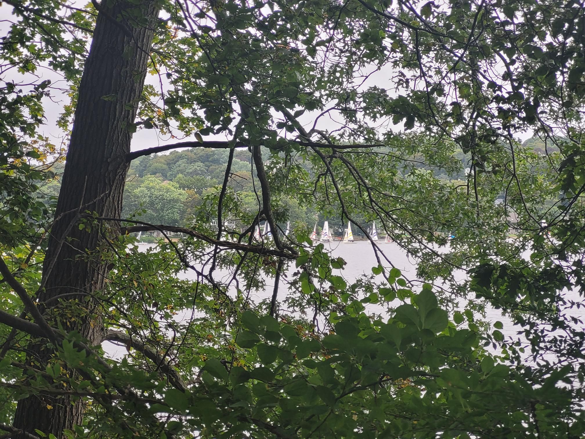

+++
title = "Post Regatta Shakedown"
description = "TrailRun — 2023-09-24"
date = 2023-09-24
authors = ["Max Katz-Christy"]

[taxonomies]
tags = ["TrailRun"]

[extra]
banner = "banner.jpg"
strava_id = 9914507277
distance_fmt = "23.37 km"
moving_time_fmt = "2h 40m 36s"
elevation_gain_fmt = "617 m"
+++

Best way to recover from a DFL'd race. Did a multimodal run, using the orange line to skip some roads. Lots of marked and unmarked trails, and a bit of bushwhacking too. I should go to the rock circuit trail more often

## Stats

| | |
|---|---|
| **Distance** | 23.37 km |
| **Moving time** | 2h 40m 36s |
| **Elapsed time** | 3h 37m 26s |
| **Elevation gain** | 617 m |
| **Average pace** | 6:52 /km |
| **Best pace** | 1:29 /km |
| **Average cadence** | 78 rpm |
| **Calories** | 1678 kcal |
| **Achievements** | 4 |
| **Device** | Garmin fēnix 6X |

## Route

{{ strava_map() }}

[View on Strava](https://www.strava.com/activities/9914507277)

## Photos

