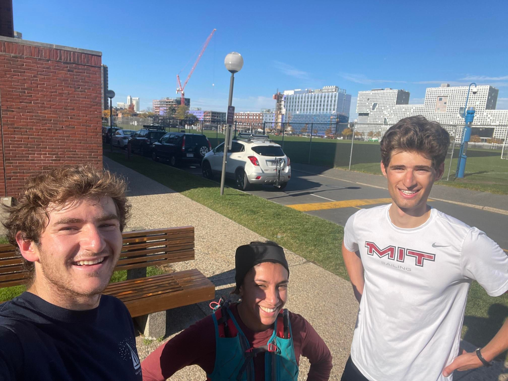

+++
title = "Sailing"
description = "Sail — 2023-10-24"
date = 2023-10-24
authors = ["Max Katz-Christy"]

[taxonomies]
tags = ["Sail"]

[extra]
banner = "banner.jpg"
strava_id = 10096175650
distance_fmt = "12.57 km"
moving_time_fmt = "1h 06m 50s"
elevation_gain_fmt = "50 m"
+++

Takes me away to where I've always heard it could be
Just a dream and the wind to carry me
Soon I will be free

## Stats

| | |
|---|---|
| **Distance** | 12.57 km |
| **Moving time** | 1h 06m 50s |
| **Elapsed time** | 1h 15m 30s |
| **Elevation gain** | 50 m |
| **Average speed** | 11.3 km/h |
| **Max speed** | 30.2 km/h |
| **Average cadence** | 77 rpm |
| **Calories** | 765 kcal |
| **Device** | Garmin fēnix 6X |

## Route

{{ strava_map() }}

[View on Strava](https://www.strava.com/activities/10096175650)

## Photos

