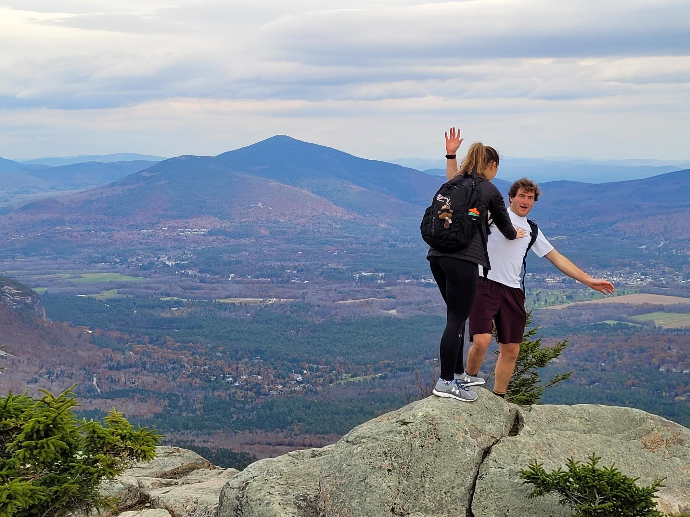

+++
title = "There's hike a bike... Then there's hiking with a bike"
description = "Hike — 2023-11-04"
date = 2023-11-04
authors = ["Max Katz-Christy"]

[taxonomies]
tags = ["Hike"]

[extra]
banner = "banner.jpg"
strava_id = 10160549916
distance_fmt = "8.83 km"
moving_time_fmt = "2h 42m 56s"
elevation_gain_fmt = "657 m"
+++

Some people are crazy, but I bet the ride down was fun

## Stats

| | |
|---|---|
| **Distance** | 8.83 km |
| **Moving time** | 2h 42m 56s |
| **Elapsed time** | 3h 57m 05s |
| **Elevation gain** | 657 m |
| **Average pace** | 18:27 /km |
| **Best pace** | 3:26 /km |
| **Average cadence** | 53 rpm |
| **Calories** | 1021 kcal |
| **Device** | Garmin fēnix 6X |

## Route

{{ strava_map() }}

[View on Strava](https://www.strava.com/activities/10160549916)

## Photos

