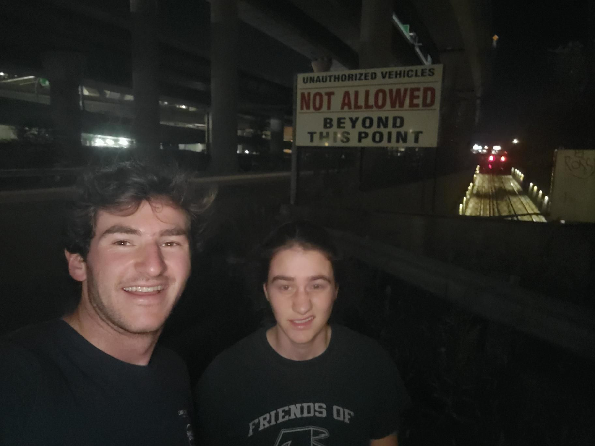

+++
title = "Still Works (heavy)"
description = "Run — 2023-11-05"
date = 2023-11-05
authors = ["Max Katz-Christy"]

[taxonomies]
tags = ["Run"]

[extra]
banner = "banner.jpg"
strava_id = 10167990653
distance_fmt = "8.03 km"
moving_time_fmt = "54m 49s"
elevation_gain_fmt = "80 m"
+++

Showed Nina the industrial way to the Schraffts Building

## Stats

| | |
|---|---|
| **Distance** | 8.03 km |
| **Moving time** | 54m 49s |
| **Elapsed time** | 59m 42s |
| **Elevation gain** | 80 m |
| **Average pace** | 6:49 /km |
| **Best pace** | 3:37 /km |
| **Average cadence** | 75 rpm |
| **Calories** | 588 kcal |
| **Achievements** | 3 |
| **Device** | Garmin fēnix 6X |

## Route

{{ strava_map() }}

[View on Strava](https://www.strava.com/activities/10167990653)

## Photos

