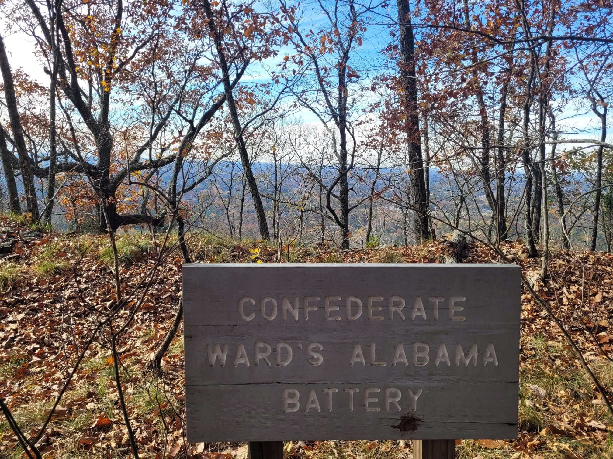

+++
title = "Battery technology has come a long way"
description = "TrailRun — 2023-11-13"
date = 2023-11-13
authors = ["Max Katz-Christy"]

[taxonomies]
tags = ["TrailRun"]

[extra]
banner = "banner.jpg"
strava_id = 10213017798
distance_fmt = "17.71 km"
moving_time_fmt = "1h 54m 21s"
elevation_gain_fmt = "569 m"
+++

Found a ridge in the greater Atlanta pancake

## Stats

| | |
|---|---|
| **Distance** | 17.71 km |
| **Moving time** | 1h 54m 21s |
| **Elapsed time** | 1h 58m 10s |
| **Elevation gain** | 569 m |
| **Average pace** | 6:27 /km |
| **Best pace** | 3:01 /km |
| **Average cadence** | 77 rpm |
| **Calories** | 1247 kcal |
| **Achievements** | 3 |
| **Device** | Garmin fēnix 6X |

## Route

{{ strava_map() }}

[View on Strava](https://www.strava.com/activities/10213017798)

## Photos

