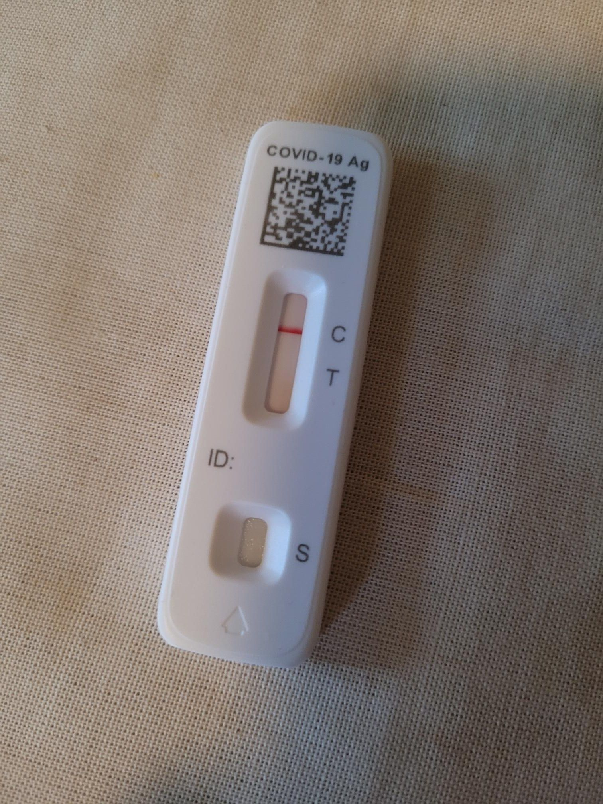

+++
title = "COVID Test"
description = "Pilates — 2023-11-21"
date = 2023-11-21
authors = ["Max Katz-Christy"]

[taxonomies]
tags = ["Pilates"]

[extra]
banner = "banner.jpg"
strava_id = 10259145158
distance_fmt = "0.45 km"
moving_time_fmt = "7m 32s"
elevation_gain_fmt = "2 m"
+++

Negative. Happy Thanksgiving!

## Stats

| | |
|---|---|
| **Distance** | 0.45 km |
| **Moving time** | 7m 32s |
| **Elapsed time** | 15m 25s |
| **Elevation gain** | 2 m |
| **Average speed** | 3.6 km/h |
| **Max speed** | 13.4 km/h |
| **Average cadence** | 19 rpm |
| **Calories** | 17 kcal |
| **Device** | Garmin fēnix 6X |

## Route

{{ strava_map() }}

[View on Strava](https://www.strava.com/activities/10259145158)

## Photos

