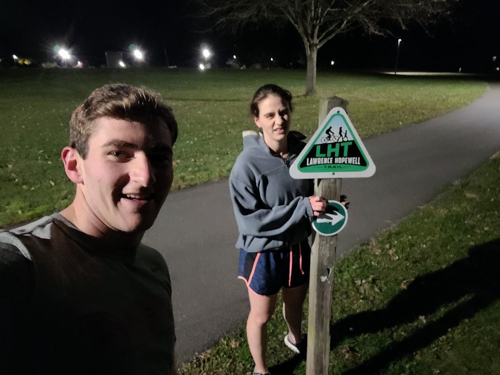

+++
title = "Post Turkey (Pre Pie) Trot"
description = "Run — 2023-11-23"
date = 2023-11-23
authors = ["Max Katz-Christy"]

[taxonomies]
tags = ["Run"]

[extra]
banner = "banner.jpg"
strava_id = 10271743648
distance_fmt = "10.01 km"
moving_time_fmt = "1h 01m 29s"
elevation_gain_fmt = "63 m"
+++

## Stats

| | |
|---|---|
| **Distance** | 10.01 km |
| **Moving time** | 1h 01m 29s |
| **Elapsed time** | 1h 03m 38s |
| **Elevation gain** | 63 m |
| **Average pace** | 6:08 /km |
| **Best pace** | 4:19 /km |
| **Average cadence** | 77 rpm |
| **Calories** | 765 kcal |
| **Achievements** | 1 |
| **Device** | Garmin fēnix 6X |

## Route

{{ strava_map() }}

[View on Strava](https://www.strava.com/activities/10271743648)

## Photos

