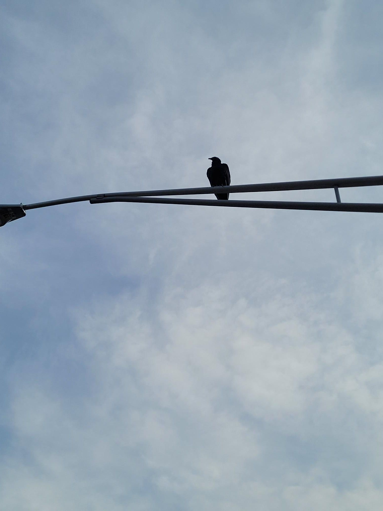

+++
title = "I saw a cool bird"
description = "Run — 2023-11-24"
date = 2023-11-24
authors = ["Max Katz-Christy"]

[taxonomies]
tags = ["Run"]

[extra]
banner = "banner.jpg"
strava_id = 10275201903
distance_fmt = "5.05 km"
moving_time_fmt = "23m 11s"
elevation_gain_fmt = "43 m"
+++

Anybody know what it is?

## Stats

| | |
|---|---|
| **Distance** | 5.05 km |
| **Moving time** | 23m 11s |
| **Elapsed time** | 23m 23s |
| **Elevation gain** | 43 m |
| **Average pace** | 4:35 /km |
| **Best pace** | 2:44 /km |
| **Average cadence** | 82 rpm |
| **Calories** | 300 kcal |
| **Achievements** | 5 |
| **Device** | Garmin fēnix 6X |

## Route

{{ strava_map() }}

[View on Strava](https://www.strava.com/activities/10275201903)

## Photos

