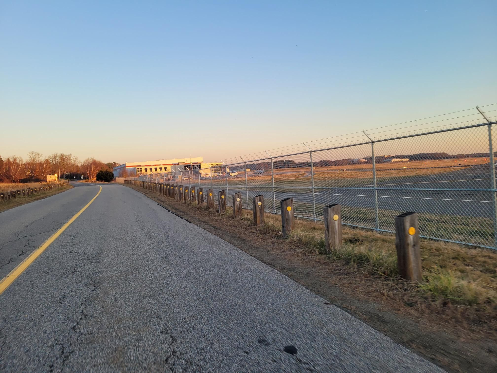

+++
title = "Please don't let me become just another roadie..."
description = "Ride — 2023-12-01"
date = 2023-12-01
authors = ["Max Katz-Christy"]

[taxonomies]
tags = ["Ride"]

[extra]
banner = "banner.jpg"
strava_id = 10311201254
distance_fmt = "57.46 km"
moving_time_fmt = "2h 08m 20s"
elevation_gain_fmt = "444 m"
+++

Idk how it happened. Running? Road biking? Getting up early for long rides? I've fallen to the dark side. I need more trail runs and bikepacking trips. Fun riding with a big group though (10 ish)

## Stats

| | |
|---|---|
| **Distance** | 57.46 km |
| **Moving time** | 2h 08m 20s |
| **Elapsed time** | 2h 23m 55s |
| **Elevation gain** | 444 m |
| **Average speed** | 26.9 km/h |
| **Max speed** | 60.4 km/h |
| **Calories** | 1203 kcal |
| **Achievements** | 34 |
| **Device** | Garmin fēnix 6X |

## Route

{{ strava_map() }}

[View on Strava](https://www.strava.com/activities/10311201254)

## Photos

