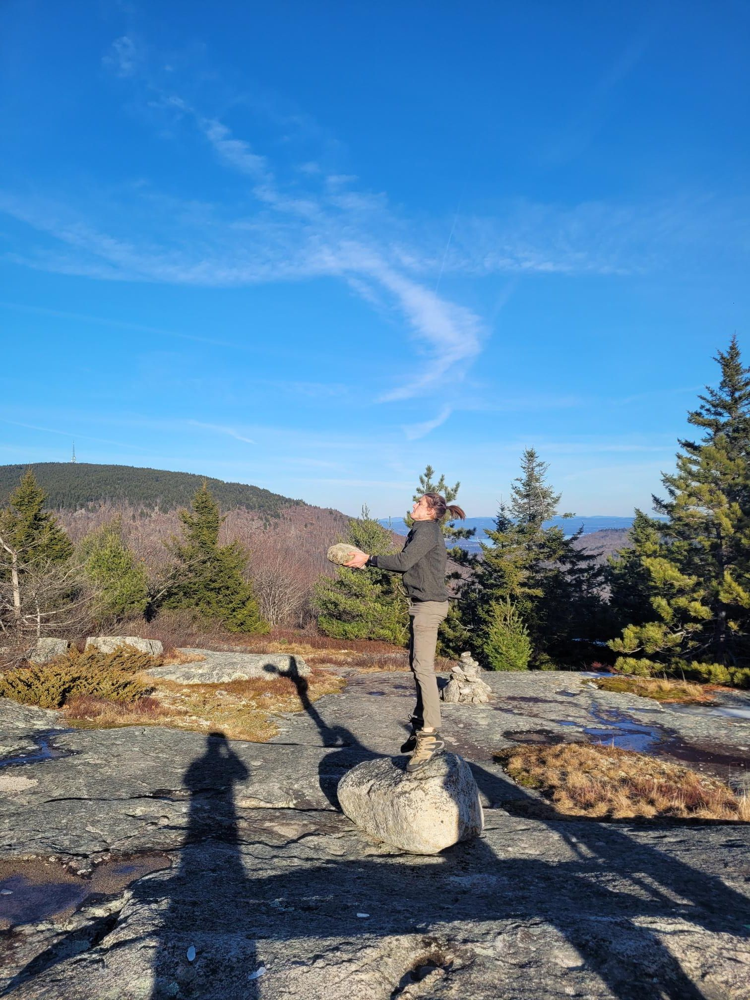

+++
title = "Please help me decide a name for the Katz family Strava club!"
description = "Hike — 2023-12-16"
date = 2023-12-16
authors = ["Max Katz-Christy"]

[taxonomies]
tags = ["Hike"]

[extra]
banner = "banner.jpg"
strava_id = 10391044215
distance_fmt = "9.13 km"
moving_time_fmt = "2h 38m 19s"
elevation_gain_fmt = "651 m"
+++

Krazy katz
Kool katz
Who let the Katz out
Bobkatz
Tabby Katz
Whisky whiskers
Katz nappers
Alley Katz
Top Kats
Kitty Katz
Kit Katz
The kittens
Katz patrol
Katz with stats
Kudo Katz
The katzpack
Katz attack
Wildkatz
Katztastrophies

## Stats

| | |
|---|---|
| **Distance** | 9.13 km |
| **Moving time** | 2h 38m 19s |
| **Elapsed time** | 5h 27m 12s |
| **Elevation gain** | 651 m |
| **Average pace** | 17:20 /km |
| **Best pace** | 4:04 /km |
| **Average cadence** | 53 rpm |
| **Calories** | 1204 kcal |
| **Device** | Garmin fēnix 6X |

## Route

{{ strava_map() }}

[View on Strava](https://www.strava.com/activities/10391044215)

## Photos

