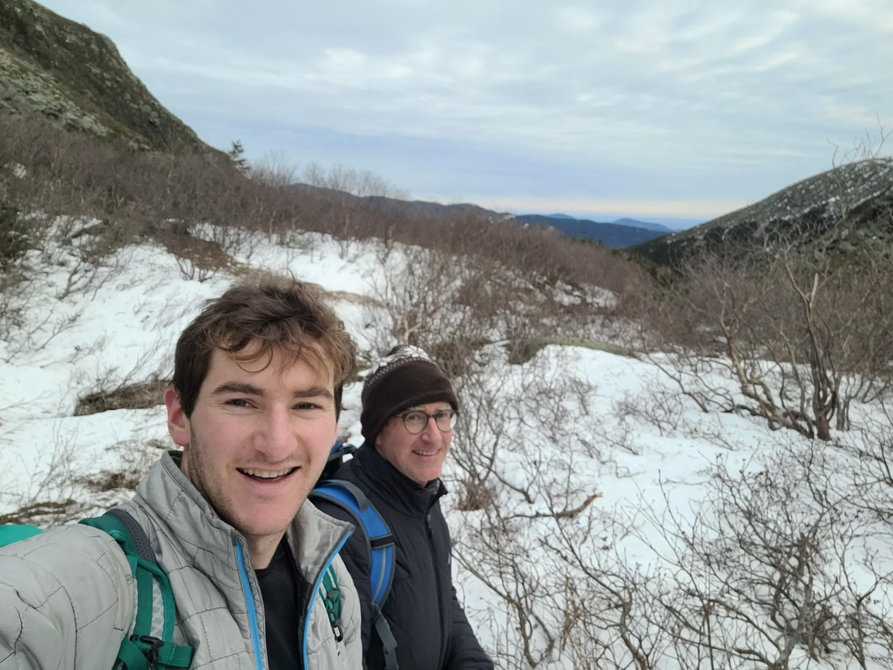

+++
title = "Not a loop, not an out and back, it's an out and back and out and back"
description = "Hike — 2023-12-23"
date = 2023-12-23
authors = ["Max Katz-Christy"]

[taxonomies]
tags = ["Hike"]

[extra]
banner = "banner.jpg"
strava_id = 10426536369
distance_fmt = "16.68 km"
moving_time_fmt = "4h 30m 14s"
elevation_gain_fmt = "1136 m"
+++

## Stats

| | |
|---|---|
| **Distance** | 16.68 km |
| **Moving time** | 4h 30m 14s |
| **Elapsed time** | 7h 10m 03s |
| **Elevation gain** | 1136 m |
| **Average pace** | 16:11 /km |
| **Best pace** | 4:16 /km |
| **Average cadence** | 58 rpm |
| **Calories** | 2093 kcal |
| **Device** | Garmin fēnix 6X |

## Route

{{ strava_map() }}

[View on Strava](https://www.strava.com/activities/10426536369)

## Photos

