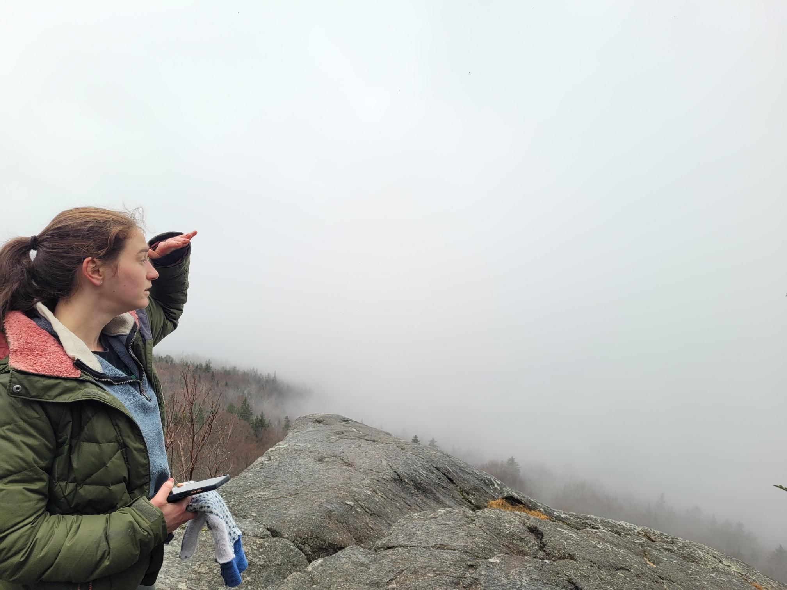

+++
title = "Found: Pond"
description = "Hike — 2023-12-25"
date = 2023-12-25
authors = ["Max Katz-Christy"]

[taxonomies]
tags = ["Hike"]

[extra]
banner = "banner.jpg"
strava_id = 10435516906
distance_fmt = "4.96 km"
moving_time_fmt = "1h 37m 55s"
elevation_gain_fmt = "192 m"
+++

It's under the ice

## Stats

| | |
|---|---|
| **Distance** | 4.96 km |
| **Moving time** | 1h 37m 55s |
| **Elapsed time** | 2h 19m 08s |
| **Elevation gain** | 192 m |
| **Average pace** | 19:43 /km |
| **Best pace** | 7:23 /km |
| **Average cadence** | 52 rpm |
| **Calories** | 611 kcal |
| **Device** | Garmin fēnix 6X |

## Route

{{ strava_map() }}

[View on Strava](https://www.strava.com/activities/10435516906)

## Photos

