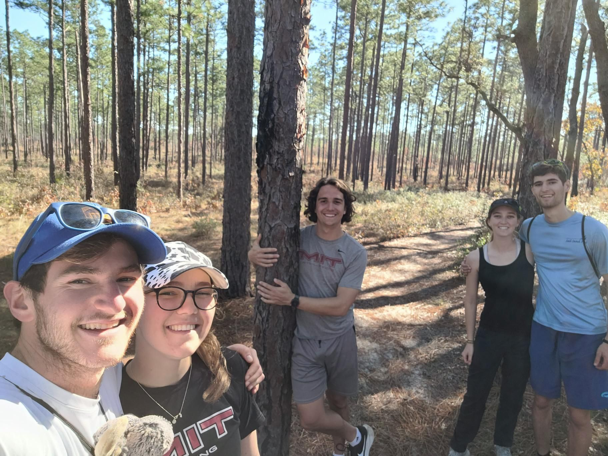

+++
title = "Burnt cactus"
description = "Hike — 2024-01-04"
date = 2024-01-04
authors = ["Max Katz-Christy"]

[taxonomies]
tags = ["Hike"]

[extra]
banner = "banner.jpg"
strava_id = 10495469623
distance_fmt = "21.46 km"
moving_time_fmt = "4h 01m 58s"
elevation_gain_fmt = "207 m"
+++

## Stats

| | |
|---|---|
| **Distance** | 21.46 km |
| **Moving time** | 4h 01m 58s |
| **Elapsed time** | 5h 04m 13s |
| **Elevation gain** | 207 m |
| **Average pace** | 11:16 /km |
| **Best pace** | 0:31 /km |
| **Average cadence** | 54 rpm |
| **Calories** | 1034 kcal |
| **Device** | Garmin fēnix 6X |

## Route

{{ strava_map() }}

[View on Strava](https://www.strava.com/activities/10495469623)

## Photos

