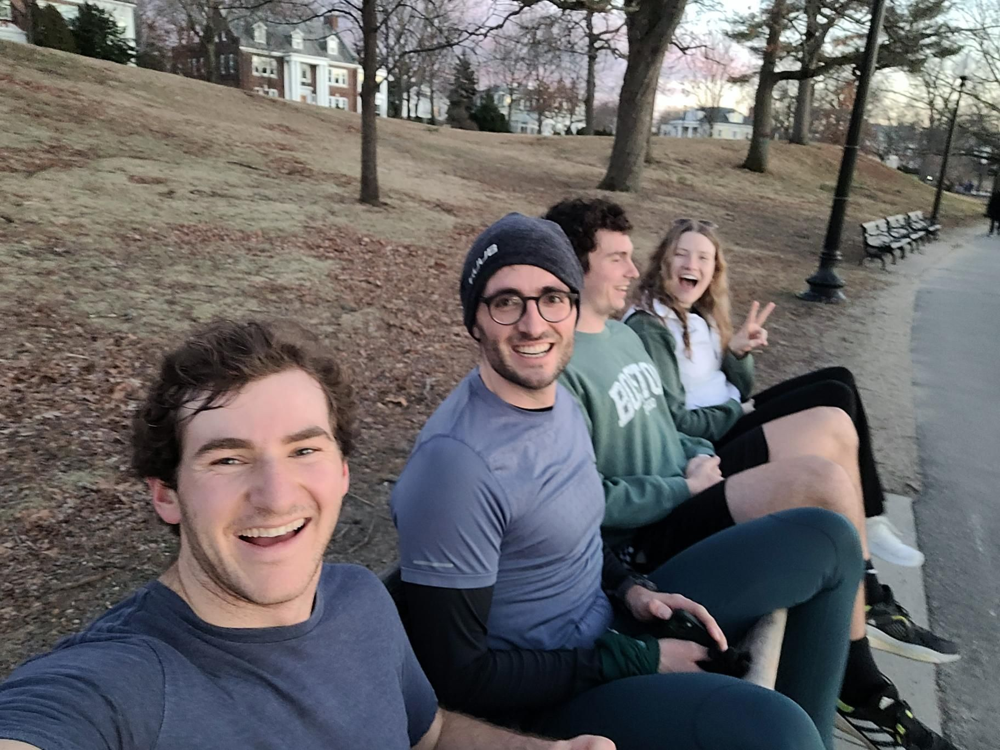

+++
title = "Like Carrots and Peas"
description = "Run — 2024-03-03"
date = 2024-03-03
authors = ["Max Katz-Christy"]

[taxonomies]
tags = ["Run"]

[extra]
banner = "banner.jpg"
strava_id = 10885068979
distance_fmt = "15.26 km"
moving_time_fmt = "1h 24m 40s"
elevation_gain_fmt = "236 m"
+++

Had fun exploring parks and interviewing people with Carl! Thanks Seth Massey for connecting us. Also, come play darts with me at pika.

## Stats

| | |
|---|---|
| **Distance** | 15.26 km |
| **Moving time** | 1h 24m 40s |
| **Elapsed time** | 1h 43m 14s |
| **Elevation gain** | 236 m |
| **Average pace** | 5:32 /km |
| **Best pace** | 3:25 /km |
| **Average cadence** | 80 rpm |
| **Calories** | 1122 kcal |
| **Achievements** | 2 |
| **Device** | Garmin fēnix 6X |

## Route

{{ strava_map() }}

[View on Strava](https://www.strava.com/activities/10885068979)

## Photos

