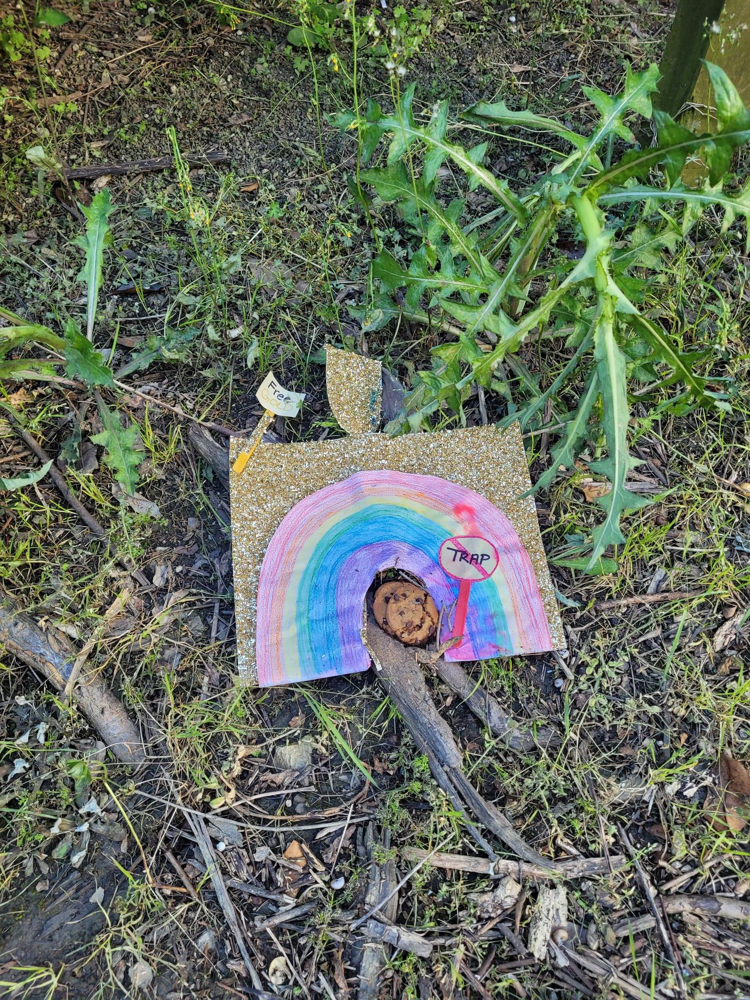

+++
title = "High 5s and Leprechauns"
description = "Run — 2024-03-25"
date = 2024-03-25
authors = ["Max Katz-Christy"]

[taxonomies]
tags = ["Run"]

[extra]
banner = "banner.jpg"
strava_id = 11038080216
distance_fmt = "1.54 km"
moving_time_fmt = "8m 50s"
elevation_gain_fmt = "10 m"
+++

## Stats

| | |
|---|---|
| **Distance** | 1.54 km |
| **Moving time** | 8m 50s |
| **Elapsed time** | 10m 53s |
| **Elevation gain** | 10 m |
| **Average pace** | 5:45 /km |
| **Best pace** | 4:25 /km |
| **Average cadence** | 78 rpm |
| **Calories** | 143 kcal |
| **Device** | Garmin fēnix 6X |

## Route

{{ strava_map() }}

[View on Strava](https://www.strava.com/activities/11038080216)

## Photos

