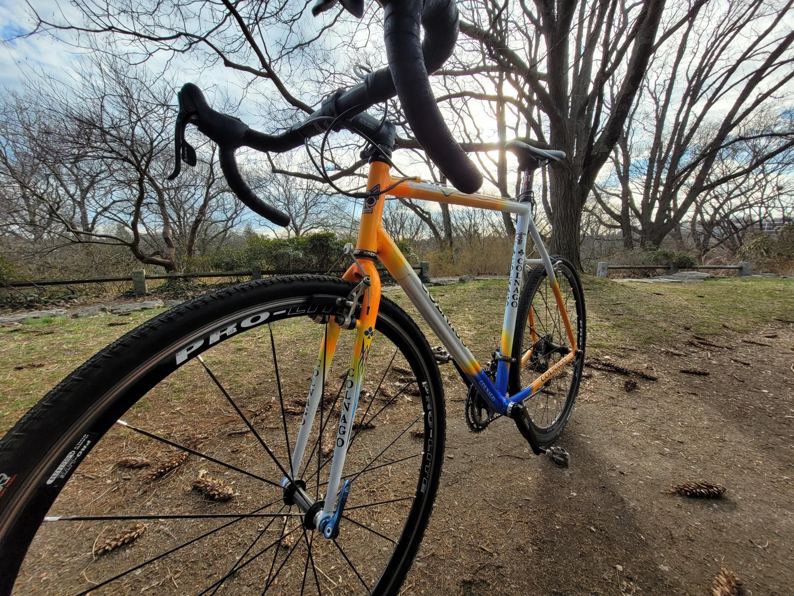

+++
title = "Colnago (MIT Cycling Loaner #5) is fully working!"
description = "Ride — 2024-04-01"
date = 2024-04-01
authors = ["Max Katz-Christy"]

[taxonomies]
tags = ["Ride"]

[extra]
banner = "banner.jpg"
strava_id = 11086564352
distance_fmt = "18.37 km"
moving_time_fmt = "44m 34s"
elevation_gain_fmt = "197 m"
+++

## Stats

| | |
|---|---|
| **Distance** | 18.37 km |
| **Moving time** | 44m 34s |
| **Elapsed time** | 51m 33s |
| **Elevation gain** | 197 m |
| **Average speed** | 24.7 km/h |
| **Max speed** | 41.5 km/h |
| **Calories** | 396 kcal |
| **Achievements** | 44 |
| **Device** | Garmin fēnix 6X |

## Route

{{ strava_map() }}

[View on Strava](https://www.strava.com/activities/11086564352)

## Photos

