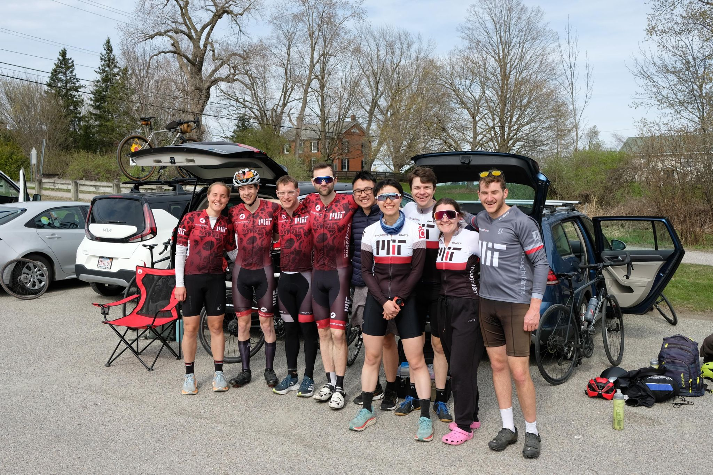

+++
title = "It was very pretty between when I got dropped and when things got a bit blurry"
description = "Ride — 2024-04-27"
date = 2024-04-27
authors = ["Max Katz-Christy"]

[taxonomies]
tags = ["Ride"]

[extra]
banner = "banner.jpg"
strava_id = 11277221386
distance_fmt = "48.02 km"
moving_time_fmt = "1h 40m 48s"
elevation_gain_fmt = "720 m"
+++

## Stats

| | |
|---|---|
| **Distance** | 48.02 km |
| **Moving time** | 1h 40m 48s |
| **Elapsed time** | 1h 42m 04s |
| **Elevation gain** | 720 m |
| **Average speed** | 28.6 km/h |
| **Max speed** | 76.8 km/h |
| **Calories** | 922 kcal |
| **Achievements** | 43 |
| **Device** | Garmin fēnix 6X |

## Route

{{ strava_map() }}

[View on Strava](https://www.strava.com/activities/11277221386)

## Photos

