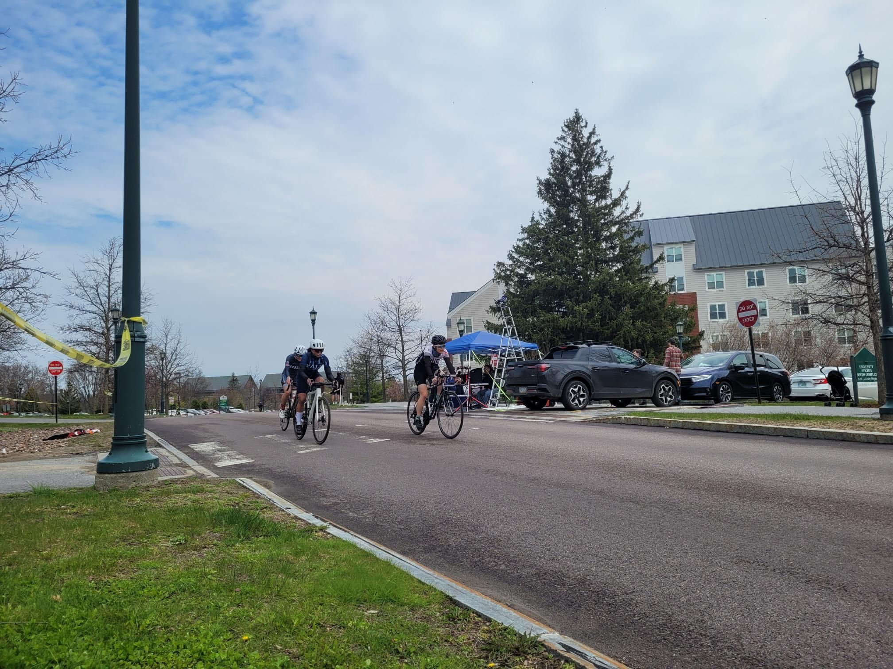

+++
title = "Intro to riding in little circles"
description = "Ride — 2024-04-28"
date = 2024-04-28
authors = ["Max Katz-Christy"]

[taxonomies]
tags = ["Ride"]

[extra]
banner = "banner.jpg"
strava_id = 11284436112
distance_fmt = "12.03 km"
moving_time_fmt = "21m 21s"
elevation_gain_fmt = "70 m"
+++

🤛

## Stats

| | |
|---|---|
| **Distance** | 12.03 km |
| **Moving time** | 21m 21s |
| **Elapsed time** | 21m 21s |
| **Elevation gain** | 70 m |
| **Average speed** | 33.8 km/h |
| **Max speed** | 45.4 km/h |
| **Calories** | 225 kcal |
| **Achievements** | 6 |
| **Device** | Garmin fēnix 6X |

## Route

{{ strava_map() }}

[View on Strava](https://www.strava.com/activities/11284436112)

## Photos

