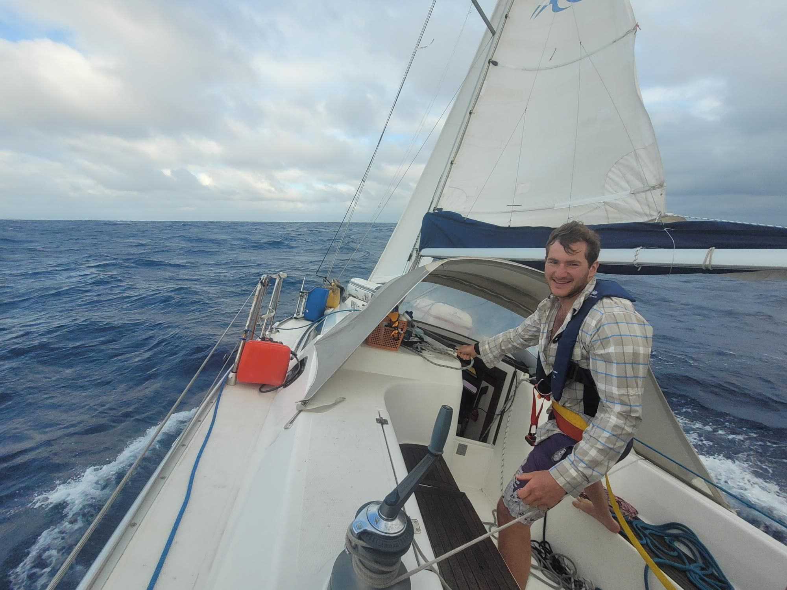

+++
title = "First big winds across the Atlantic also if you or people you know are in Europe this summer lmk"
description = "Sail — 2024-05-27"
date = 2024-05-27
authors = ["Max Katz-Christy"]

[taxonomies]
tags = ["Sail"]

[extra]
banner = "banner.jpg"
strava_id = 11518352359
distance_fmt = "1.49 km"
moving_time_fmt = "8m 10s"
elevation_gain_fmt = "0 m"
+++

25 gusting to 30kts and big swell in our 35 foot boat. Gotta put at least few minutes of it on Strava or how will I know that I actually did it?

## Stats

| | |
|---|---|
| **Distance** | 1.49 km |
| **Moving time** | 8m 10s |
| **Elapsed time** | 8m 10s |
| **Elevation gain** | 0 m |
| **Average speed** | 10.9 km/h |
| **Max speed** | 12.5 km/h |
| **Average cadence** | 18 rpm |
| **Calories** | 341 kcal |
| **Device** | Garmin fēnix 6X |

## Route

{{ strava_map() }}

[View on Strava](https://www.strava.com/activities/11518352359)

## Photos

