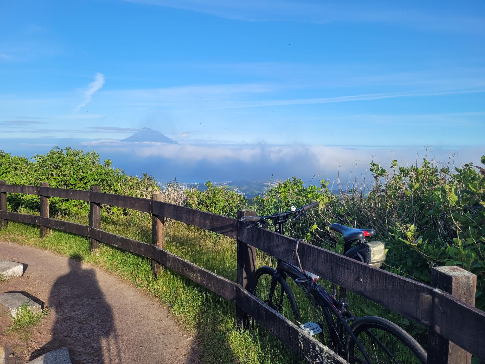

+++
title = "Gradient ascent navigation worked"
description = "Ride — 2024-06-12"
date = 2024-06-12
authors = ["Max Katz-Christy"]

[taxonomies]
tags = ["Ride"]

[extra]
banner = "banner.jpg"
strava_id = 11638613858
distance_fmt = "17.12 km"
moving_time_fmt = "2h 02m 21s"
elevation_gain_fmt = "900 m"
+++

## Stats

| | |
|---|---|
| **Distance** | 17.12 km |
| **Moving time** | 2h 02m 21s |
| **Elapsed time** | 2h 10m 58s |
| **Elevation gain** | 900 m |
| **Average speed** | 8.4 km/h |
| **Max speed** | 23.9 km/h |
| **Calories** | 1131 kcal |
| **Device** | Garmin fēnix 6X |

## Route

{{ strava_map() }}

[View on Strava](https://www.strava.com/activities/11638613858)

## Photos

