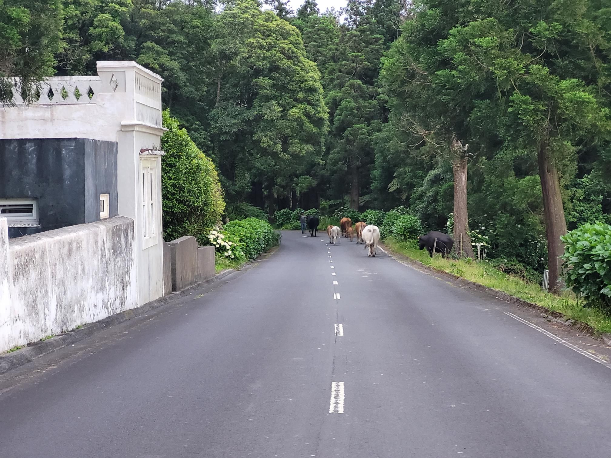

+++
title = "I got stuck behind a herd of cattle"
description = "Ride — 2024-06-12"
date = 2024-06-12
authors = ["Max Katz-Christy"]

[taxonomies]
tags = ["Ride"]

[extra]
banner = "banner.jpg"
strava_id = 11638606600
distance_fmt = "17.14 km"
moving_time_fmt = "37m 43s"
elevation_gain_fmt = "18 m"
+++

Also no flamingos allowed

## Stats

| | |
|---|---|
| **Distance** | 17.14 km |
| **Moving time** | 37m 43s |
| **Elapsed time** | 38m 20s |
| **Elevation gain** | 18 m |
| **Average speed** | 27.3 km/h |
| **Max speed** | 44.5 km/h |
| **Calories** | 194 kcal |
| **Device** | Garmin fēnix 6X |

## Route

{{ strava_map() }}

[View on Strava](https://www.strava.com/activities/11638606600)

## Photos

