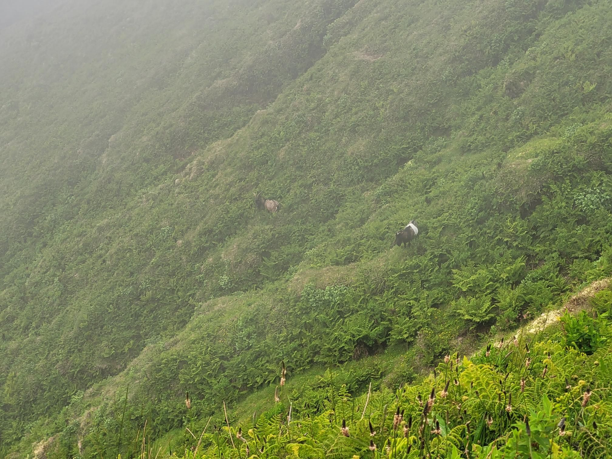

+++
title = "Volcano Goats"
description = "Hike — 2024-06-12"
date = 2024-06-12
authors = ["Max Katz-Christy"]

[taxonomies]
tags = ["Hike"]

[extra]
banner = "banner.jpg"
strava_id = 11638614226
distance_fmt = "3.20 km"
moving_time_fmt = "46m 44s"
elevation_gain_fmt = "172 m"
+++

## Stats

| | |
|---|---|
| **Distance** | 3.20 km |
| **Moving time** | 46m 44s |
| **Elapsed time** | 49m 02s |
| **Elevation gain** | 172 m |
| **Average pace** | 14:35 /km |
| **Best pace** | 5:59 /km |
| **Average cadence** | 54 rpm |
| **Calories** | 420 kcal |
| **Device** | Garmin fēnix 6X |

## Route

{{ strava_map() }}

[View on Strava](https://www.strava.com/activities/11638614226)

## Photos

