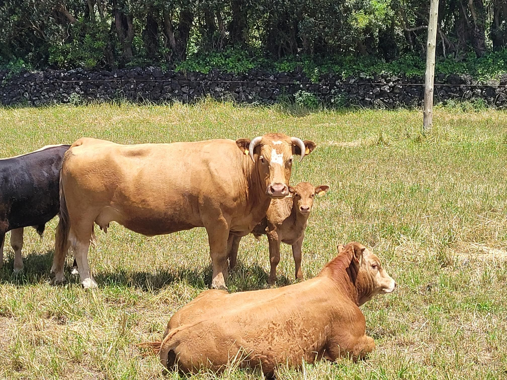

+++
title = "I thought I should take the back roads to avoid traffic but the back roads are barely paved and the main road is a farm road"
description = "Ride — 2024-06-14"
date = 2024-06-14
authors = ["Max Katz-Christy"]

[taxonomies]
tags = ["Ride"]

[extra]
banner = "banner.jpg"
strava_id = 11653694295
distance_fmt = "18.49 km"
moving_time_fmt = "2h 52m 59s"
elevation_gain_fmt = "1199 m"
+++

## Stats

| | |
|---|---|
| **Distance** | 18.49 km |
| **Moving time** | 2h 52m 59s |
| **Elapsed time** | 3h 05m 40s |
| **Elevation gain** | 1199 m |
| **Average speed** | 6.4 km/h |
| **Max speed** | 31.6 km/h |
| **Calories** | 1491 kcal |
| **Device** | Garmin fēnix 6X |

## Route

{{ strava_map() }}

[View on Strava](https://www.strava.com/activities/11653694295)

## Photos

