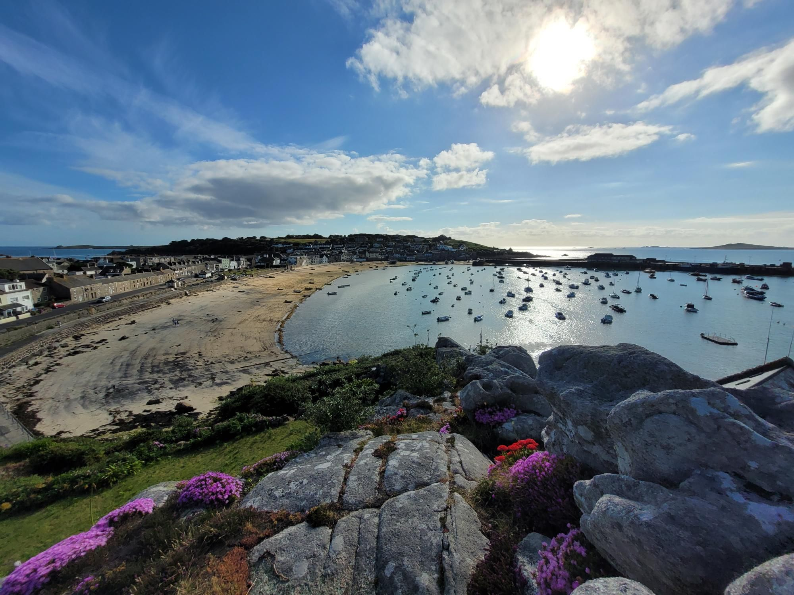

+++
title = "Isles of Silly"
description = "TrailRun — 2024-06-28"
date = 2024-06-28
authors = ["Max Katz-Christy"]

[taxonomies]
tags = ["TrailRun"]

[extra]
banner = "banner.jpg"
strava_id = 11761778986
distance_fmt = "12.60 km"
moving_time_fmt = "1h 19m 23s"
elevation_gain_fmt = "239 m"
+++

Sorry to those I've already made this joke to

## Stats

| | |
|---|---|
| **Distance** | 12.60 km |
| **Moving time** | 1h 19m 23s |
| **Elapsed time** | 1h 28m 35s |
| **Elevation gain** | 239 m |
| **Average pace** | 6:18 /km |
| **Best pace** | 3:26 /km |
| **Average cadence** | 78 rpm |
| **Calories** | 1104 kcal |
| **Device** | Garmin fēnix 6X |

## Route

{{ strava_map() }}

[View on Strava](https://www.strava.com/activities/11761778986)

## Photos

