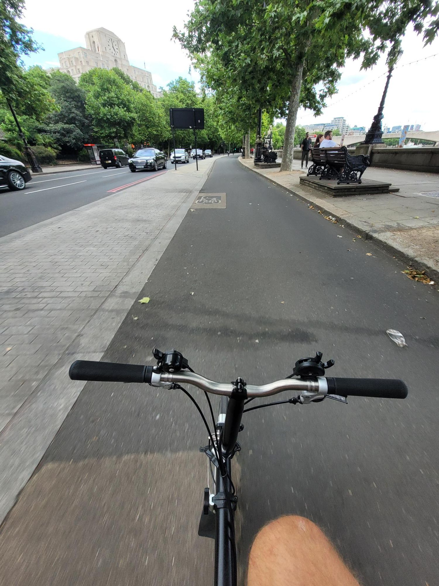

+++
title = "Oops, I got a new bike 😬"
description = "Ride — 2024-06-30"
date = 2024-06-30
authors = ["Max Katz-Christy"]

[taxonomies]
tags = ["Ride"]

[extra]
banner = "banner.jpg"
strava_id = 11776520326
distance_fmt = "4.52 km"
moving_time_fmt = "15m 48s"
elevation_gain_fmt = "35 m"
+++

It'll be nice on the train though

## Stats

| | |
|---|---|
| **Distance** | 4.52 km |
| **Moving time** | 15m 48s |
| **Elapsed time** | 18m 26s |
| **Elevation gain** | 35 m |
| **Average speed** | 17.2 km/h |
| **Max speed** | 35.0 km/h |
| **Calories** | 189 kcal |
| **Device** | Garmin fēnix 6X |

## Route

{{ strava_map() }}

[View on Strava](https://www.strava.com/activities/11776520326)

## Photos

