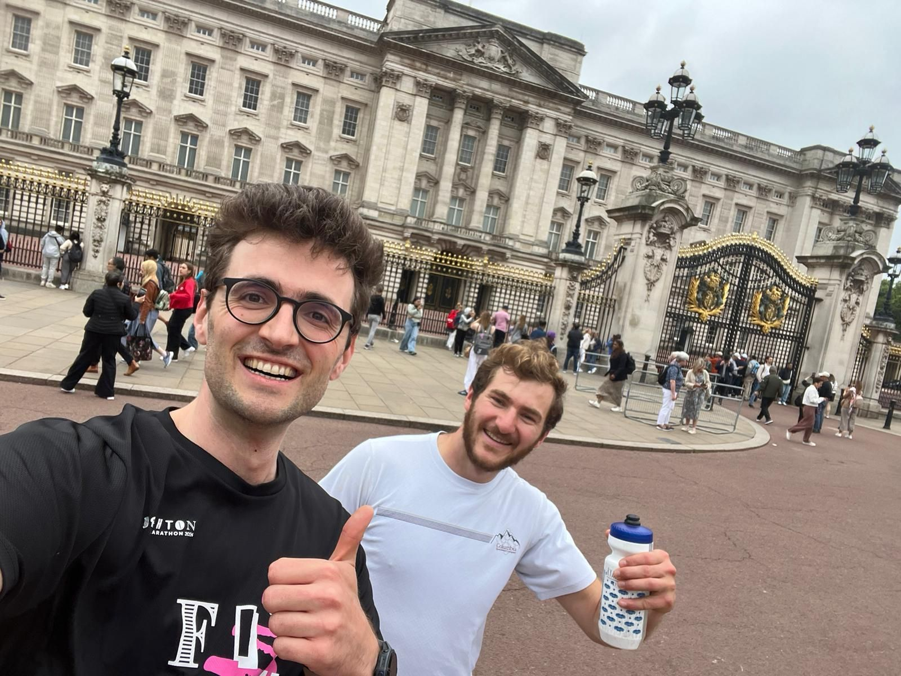

+++
title = "Carl returns the favor"
description = "Run — 2024-07-01"
date = 2024-07-01
authors = ["Max Katz-Christy"]

[taxonomies]
tags = ["Run"]

[extra]
banner = "banner.jpg"
strava_id = 11784177908
distance_fmt = "12.54 km"
moving_time_fmt = "1h 13m 45s"
elevation_gain_fmt = "67 m"
+++

## Stats

| | |
|---|---|
| **Distance** | 12.54 km |
| **Moving time** | 1h 13m 45s |
| **Elapsed time** | 1h 35m 51s |
| **Elevation gain** | 67 m |
| **Average pace** | 5:52 /km |
| **Best pace** | 1:31 /km |
| **Average cadence** | 77 rpm |
| **Calories** | 955 kcal |
| **Device** | Garmin fēnix 6X |

## Route

{{ strava_map() }}

[View on Strava](https://www.strava.com/activities/11784177908)

## Photos

