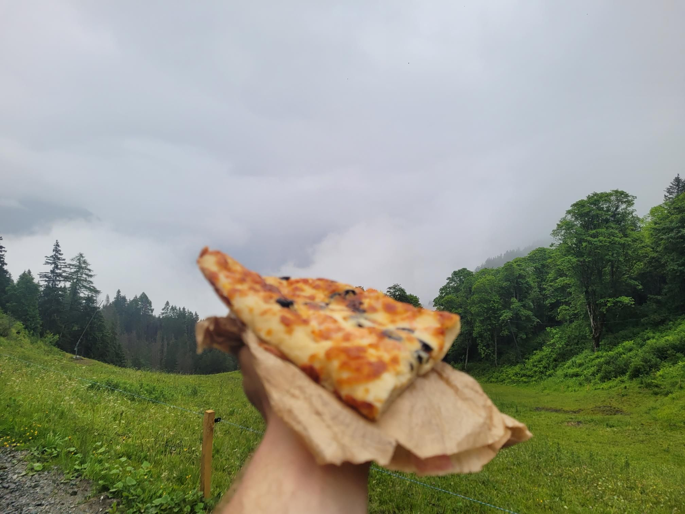

+++
title = "Finding Julius"
description = "Hike — 2024-07-03"
date = 2024-07-03
authors = ["Max Katz-Christy"]

[taxonomies]
tags = ["Hike"]

[extra]
banner = "banner.jpg"
strava_id = 11801183940
distance_fmt = "19.72 km"
moving_time_fmt = "4h 03m 33s"
elevation_gain_fmt = "1123 m"
+++

## Stats

| | |
|---|---|
| **Distance** | 19.72 km |
| **Moving time** | 4h 03m 33s |
| **Elapsed time** | 4h 14m 02s |
| **Elevation gain** | 1123 m |
| **Average pace** | 12:20 /km |
| **Best pace** | 3:44 /km |
| **Average cadence** | 56 rpm |
| **Calories** | 1684 kcal |
| **Device** | Garmin fēnix 6X |

## Route

{{ strava_map() }}

[View on Strava](https://www.strava.com/activities/11801183940)

## Photos

