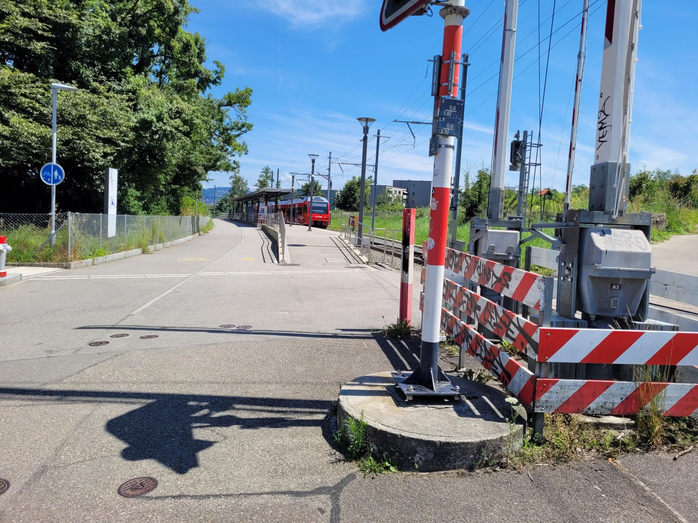

+++
title = "Less bags, more heat. Also tgtg senior center"
description = "Hike — 2024-07-09"
date = 2024-07-09
authors = ["Max Katz-Christy"]

[taxonomies]
tags = ["Hike"]

[extra]
banner = "banner.jpg"
strava_id = 11845722813
distance_fmt = "5.41 km"
moving_time_fmt = "1h 10m 22s"
elevation_gain_fmt = "238 m"
+++

## Stats

| | |
|---|---|
| **Distance** | 5.41 km |
| **Moving time** | 1h 10m 22s |
| **Elapsed time** | 1h 15m 18s |
| **Elevation gain** | 238 m |
| **Average pace** | 13:00 /km |
| **Best pace** | 4:34 /km |
| **Average cadence** | 52 rpm |
| **Calories** | 360 kcal |
| **Device** | Garmin fēnix 6X |

## Route

{{ strava_map() }}

[View on Strava](https://www.strava.com/activities/11845722813)

## Photos

