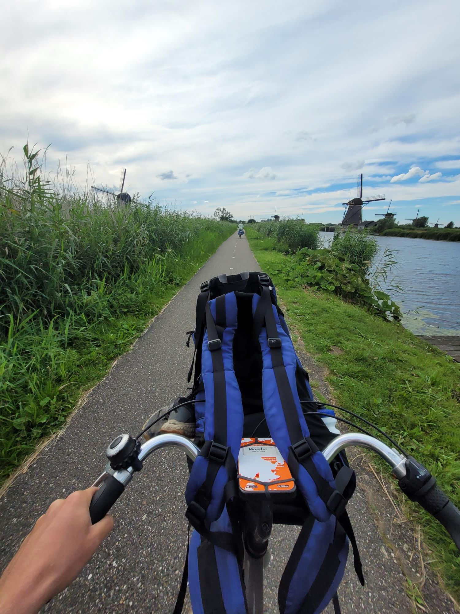

+++
title = "Windmills and swimming"
description = "Ride — 2024-07-14"
date = 2024-07-14
authors = ["Max Katz-Christy"]

[taxonomies]
tags = ["Ride"]

[extra]
banner = "banner.jpg"
strava_id = 11887385250
distance_fmt = "1.71 km"
moving_time_fmt = "7m 17s"
elevation_gain_fmt = "10 m"
+++

## Stats

| | |
|---|---|
| **Distance** | 1.71 km |
| **Moving time** | 7m 17s |
| **Elapsed time** | 8m 08s |
| **Elevation gain** | 10 m |
| **Average speed** | 14.1 km/h |
| **Max speed** | 30.3 km/h |
| **Calories** | 47 kcal |
| **Device** | Garmin fēnix 6X |

## Route

{{ strava_map() }}

[View on Strava](https://www.strava.com/activities/11887385250)

## Photos

