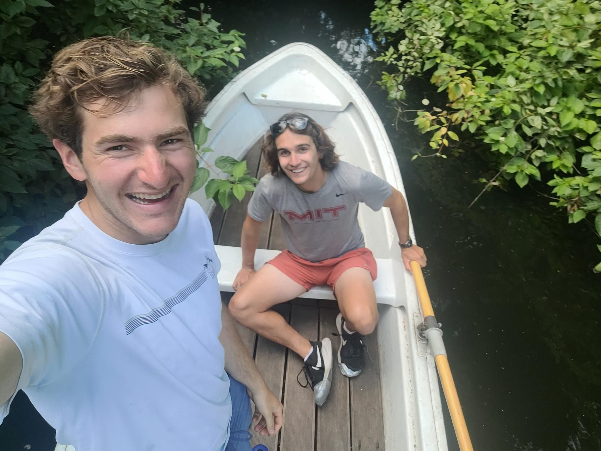

+++
title = "Beer garden leftovers are tasty"
description = "Rowing — 2024-07-19"
date = 2024-07-19
authors = ["Max Katz-Christy"]

[taxonomies]
tags = ["Rowing"]

[extra]
banner = "banner.jpg"
strava_id = 11926625188
distance_fmt = "0.92 km"
moving_time_fmt = "19m 44s"
elevation_gain_fmt = "1 m"
+++

## Stats

| | |
|---|---|
| **Distance** | 0.92 km |
| **Moving time** | 19m 44s |
| **Elapsed time** | 34m 13s |
| **Elevation gain** | 1 m |
| **Average speed** | 2.8 km/h |
| **Max speed** | 6.3 km/h |
| **Device** | Garmin fēnix 6X |

## Route

{{ strava_map() }}

[View on Strava](https://www.strava.com/activities/11926625188)

## Photos

