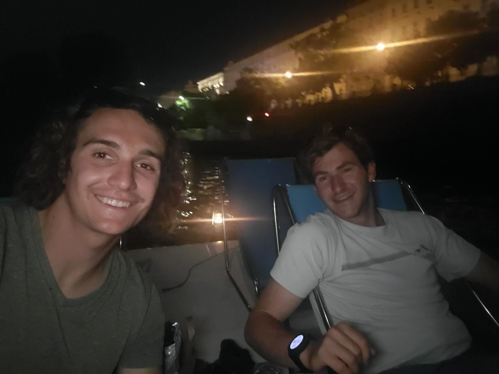

+++
title = "Paddle boating is so much easier than rowing"
description = "Rowing — 2024-07-20"
date = 2024-07-20
authors = ["Max Katz-Christy"]

[taxonomies]
tags = ["Rowing"]

[extra]
banner = "banner.jpg"
strava_id = 11938675039
distance_fmt = "2.83 km"
moving_time_fmt = "58m 25s"
elevation_gain_fmt = "10 m"
+++

## Stats

| | |
|---|---|
| **Distance** | 2.83 km |
| **Moving time** | 58m 25s |
| **Elapsed time** | 1h 05m 46s |
| **Elevation gain** | 10 m |
| **Average speed** | 2.9 km/h |
| **Max speed** | 6.4 km/h |
| **Device** | Garmin fēnix 6X |

## Route

{{ strava_map() }}

[View on Strava](https://www.strava.com/activities/11938675039)

## Photos

