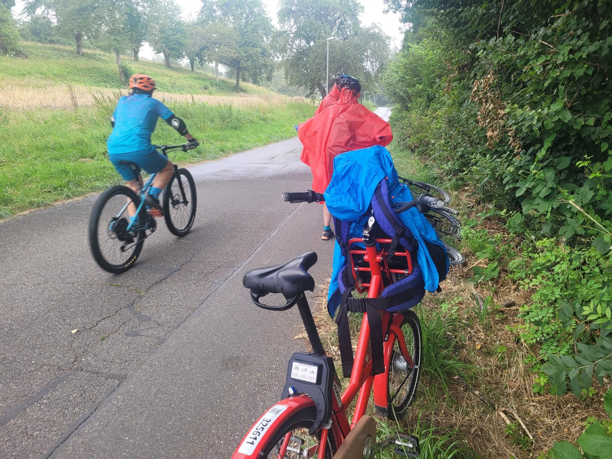

+++
title = "Ripe wild blackberries and CVT (I miss blue bikes, but they should consider better front racks)"
description = "Ride — 2024-07-22"
date = 2024-07-22
authors = ["Max Katz-Christy"]

[taxonomies]
tags = ["Ride"]

[extra]
banner = "banner.jpg"
strava_id = 11950636439
distance_fmt = "35.75 km"
moving_time_fmt = "2h 30m 39s"
elevation_gain_fmt = "278 m"
+++

## Stats

| | |
|---|---|
| **Distance** | 35.75 km |
| **Moving time** | 2h 30m 39s |
| **Elapsed time** | 3h 01m 02s |
| **Elevation gain** | 278 m |
| **Average speed** | 14.2 km/h |
| **Max speed** | 39.4 km/h |
| **Calories** | 926 kcal |
| **Device** | Garmin fēnix 6X |

## Route

{{ strava_map() }}

[View on Strava](https://www.strava.com/activities/11950636439)

## Photos

