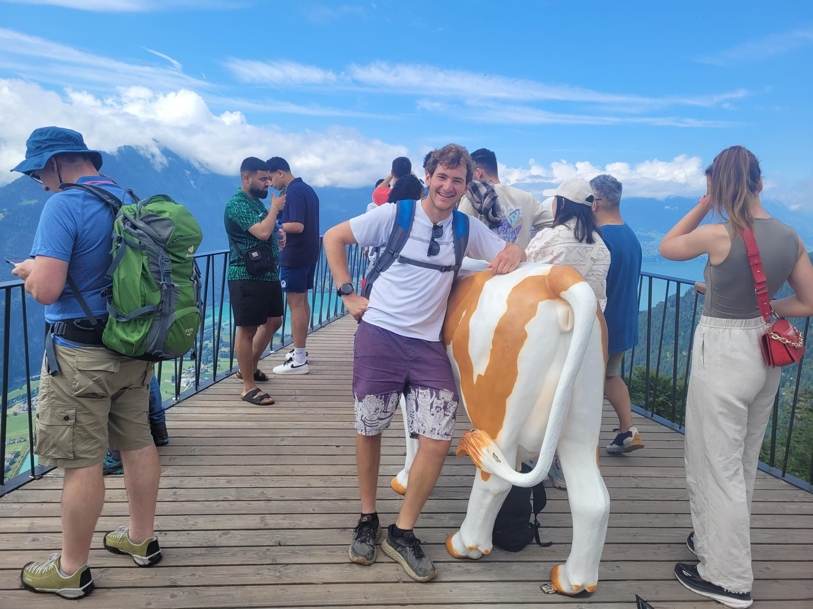

+++
title = "Fiberglass cows, fast slides, and paddle boats"
description = "Hike — 2024-07-23"
date = 2024-07-23
authors = ["Max Katz-Christy"]

[taxonomies]
tags = ["Hike"]

[extra]
banner = "banner.jpg"
strava_id = 11960585621
distance_fmt = "14.02 km"
moving_time_fmt = "4h 41m 30s"
elevation_gain_fmt = "1389 m"
+++

## Stats

| | |
|---|---|
| **Distance** | 14.02 km |
| **Moving time** | 4h 41m 30s |
| **Elapsed time** | 6h 14m 50s |
| **Elevation gain** | 1389 m |
| **Average pace** | 20:04 /km |
| **Best pace** | 4:58 /km |
| **Average cadence** | 53 rpm |
| **Calories** | 1749 kcal |
| **Device** | Garmin fēnix 6X |

## Route

{{ strava_map() }}

[View on Strava](https://www.strava.com/activities/11960585621)

## Photos

