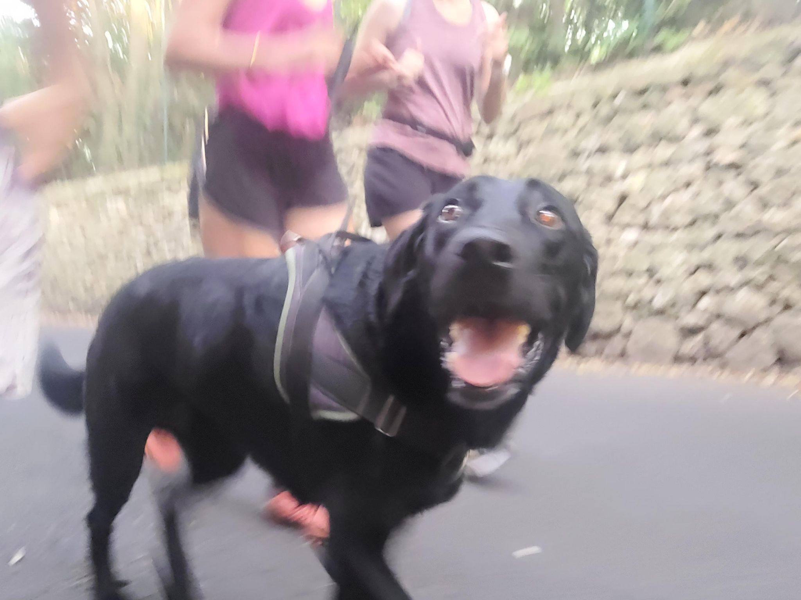

+++
title = "Cat cat dog"
description = "TrailRun — 2024-07-27"
date = 2024-07-27
authors = ["Max Katz-Christy"]

[taxonomies]
tags = ["TrailRun"]

[extra]
banner = "banner.jpg"
strava_id = 11990855586
distance_fmt = "8.08 km"
moving_time_fmt = "1h 11m 41s"
elevation_gain_fmt = "87 m"
+++

## Stats

| | |
|---|---|
| **Distance** | 8.08 km |
| **Moving time** | 1h 11m 41s |
| **Elapsed time** | 1h 12m 38s |
| **Elevation gain** | 87 m |
| **Average pace** | 8:52 /km |
| **Best pace** | 4:14 /km |
| **Average cadence** | 75 rpm |
| **Calories** | 587 kcal |
| **Achievements** | 4 |
| **Device** | Garmin fēnix 6X |

## Route

{{ strava_map() }}

[View on Strava](https://www.strava.com/activities/11990855586)

## Photos

