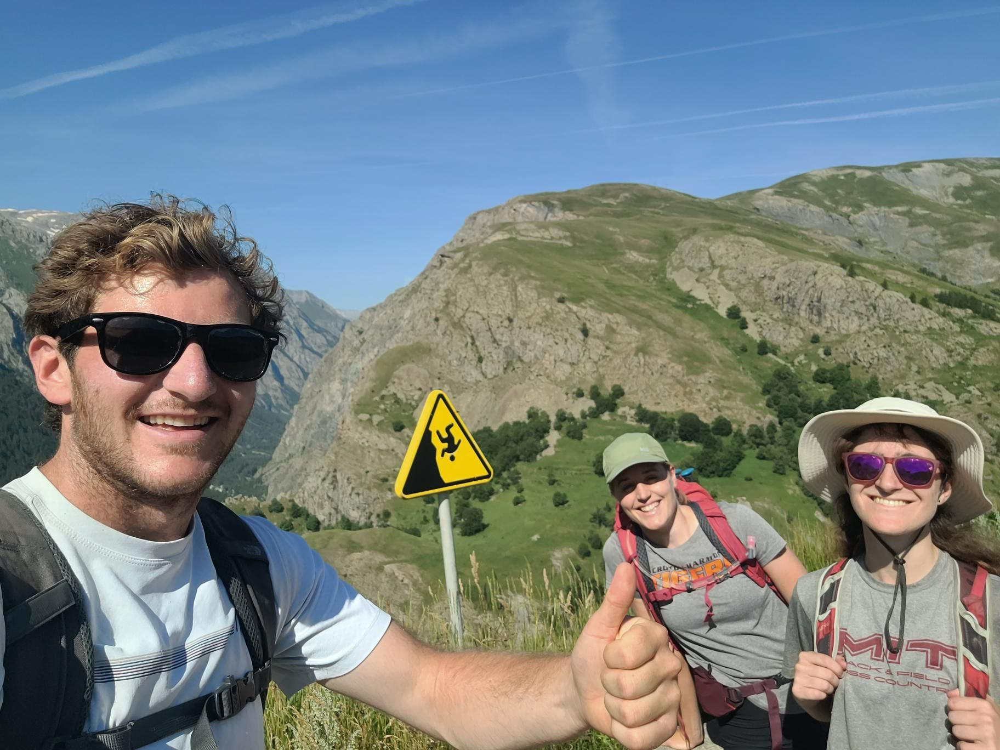

+++
title = "Pas de courir"
description = "Hike — 2024-07-30"
date = 2024-07-30
authors = ["Max Katz-Christy"]

[taxonomies]
tags = ["Hike"]

[extra]
banner = "banner.jpg"
strava_id = 12019032371
distance_fmt = "25.89 km"
moving_time_fmt = "5h 57m 54s"
elevation_gain_fmt = "1247 m"
+++

## Stats

| | |
|---|---|
| **Distance** | 25.89 km |
| **Moving time** | 5h 57m 54s |
| **Elapsed time** | 7h 54m 10s |
| **Elevation gain** | 1247 m |
| **Average pace** | 13:49 /km |
| **Best pace** | 3:03 /km |
| **Average cadence** | 54 rpm |
| **Calories** | 2396 kcal |
| **Device** | Garmin fēnix 6X |

## Route

{{ strava_map() }}

[View on Strava](https://www.strava.com/activities/12019032371)

## Photos

