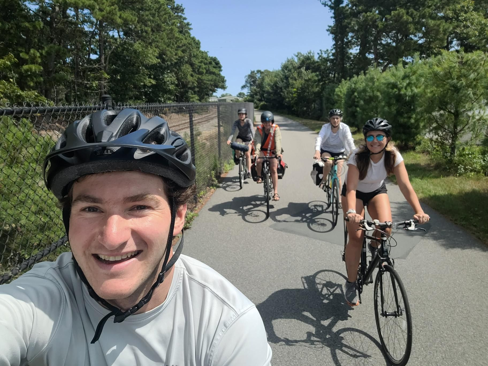

+++
title = "Brooke Streets"
description = "Ride — 2024-08-21"
date = 2024-08-21
authors = ["Max Katz-Christy"]

[taxonomies]
tags = ["Ride"]

[extra]
banner = "banner.jpg"
strava_id = 12207110932
distance_fmt = "14.44 km"
moving_time_fmt = "56m 21s"
elevation_gain_fmt = "80 m"
+++

## Stats

| | |
|---|---|
| **Distance** | 14.44 km |
| **Moving time** | 56m 21s |
| **Elapsed time** | 1h 20m 16s |
| **Elevation gain** | 80 m |
| **Average speed** | 15.4 km/h |
| **Max speed** | 33.6 km/h |
| **Calories** | 445 kcal |
| **Device** | Garmin fēnix 6X |

## Route

{{ strava_map() }}

[View on Strava](https://www.strava.com/activities/12207110932)

## Photos

