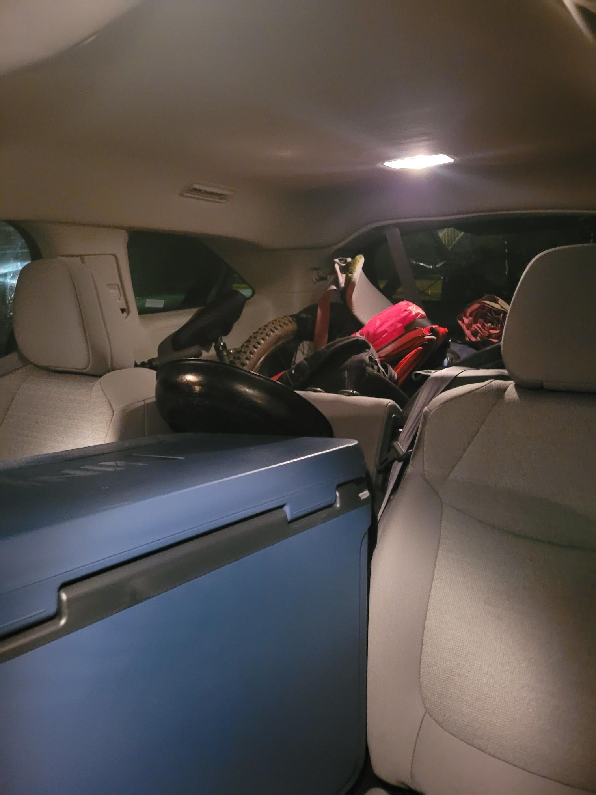

+++
title = "Bermie Senders XC"
description = "MountainBikeRide — 2024-09-07"
date = 2024-09-07
authors = ["Max Katz-Christy"]

[taxonomies]
tags = ["MountainBikeRide"]

[extra]
banner = "banner.jpg"
strava_id = 12351150022
distance_fmt = "17.50 km"
moving_time_fmt = "1h 05m 48s"
elevation_gain_fmt = "276 m"
+++

We got the big cooler

## Stats

| | |
|---|---|
| **Distance** | 17.50 km |
| **Moving time** | 1h 05m 48s |
| **Elapsed time** | 1h 12m 42s |
| **Elevation gain** | 276 m |
| **Average speed** | 16.0 km/h |
| **Max speed** | 36.8 km/h |
| **Calories** | 891 kcal |
| **Achievements** | 8 |
| **Device** | Garmin fēnix 6X |

## Route

{{ strava_map() }}

[View on Strava](https://www.strava.com/activities/12351150022)

## Photos

