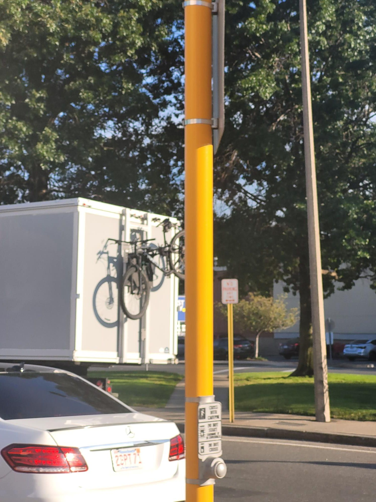

+++
title = "Don't yell at the people playing Pokemon in the park"
description = "Ride — 2024-09-11"
date = 2024-09-11
authors = ["Max Katz-Christy"]

[taxonomies]
tags = ["Ride"]

[extra]
banner = "banner.jpg"
strava_id = 12387624545
distance_fmt = "26.22 km"
moving_time_fmt = "1h 16m 51s"
elevation_gain_fmt = "137 m"
+++

I guess it's a weekly activity? Also a 24ft truck with bikes on the back and an MIT bus getting towed. An eventful cx practice

## Stats

| | |
|---|---|
| **Distance** | 26.22 km |
| **Moving time** | 1h 16m 51s |
| **Elapsed time** | 1h 55m 55s |
| **Elevation gain** | 137 m |
| **Average speed** | 20.5 km/h |
| **Max speed** | 36.9 km/h |
| **Calories** | 840 kcal |
| **Achievements** | 9 |
| **Device** | Garmin fēnix 6X |

## Route

{{ strava_map() }}

[View on Strava](https://www.strava.com/activities/12387624545)

## Photos

